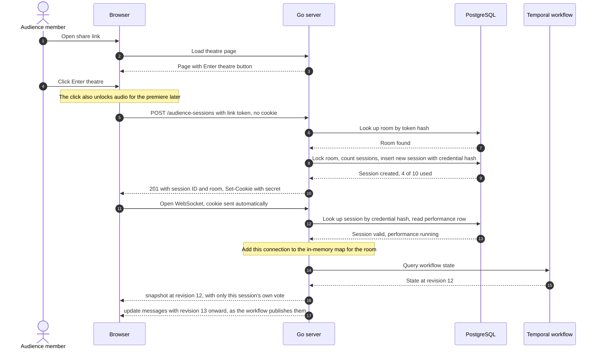
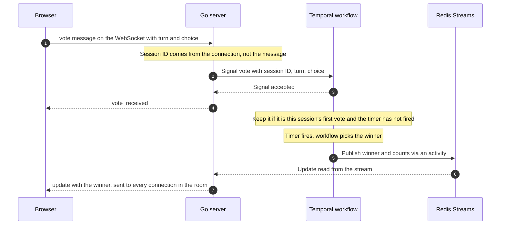
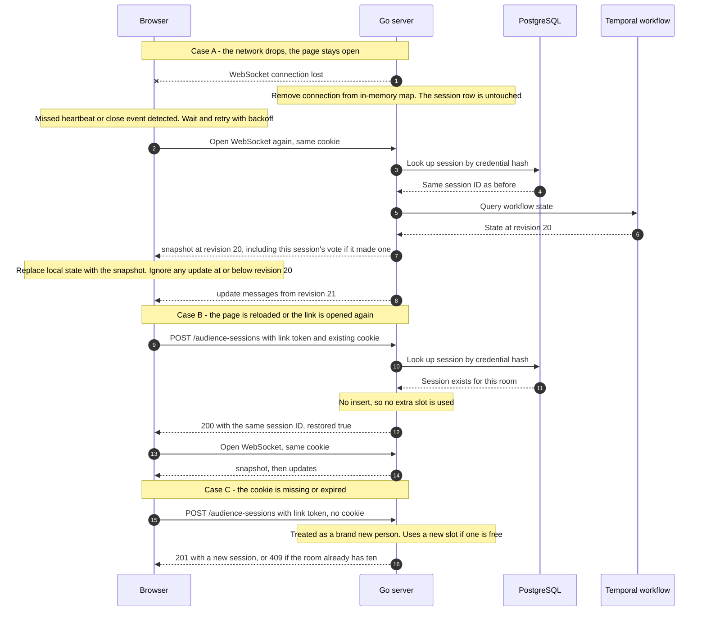

# Audience Session — Schema and Connection Flow

Status: updated 2026-10-07 for the simplified design. The session scheme described here was accepted on 2026-10-08 as D030 in [the decisions log](decisions.md). Exact column types remain an implementation detail.

## The idea in one paragraph

An audience member has no account. The share link proves they were invited to a room. The first time they click **Enter theatre**, the server creates a session row, generates a long random secret, and hands that secret to the browser in a cookie. From then on the cookie is the person's identity: every page reload and every WebSocket connection sends it, and the server looks up the same session row. "Reconnection" is therefore nothing special. It is just another request that carries the same cookie.

Two things are kept separate throughout:

- **Identity** is the session row in PostgreSQL. It is durable and survives disconnects, reloads, and server restarts.
- **Connection** is a live WebSocket held in server memory, one per browser. It comes and goes, and losing it changes nothing about identity or the audience slot.

## Schema

### Table: `audience_sessions`

| Column | Type | Purpose |
| --- | --- | --- |
| `id` | `uuid`, primary key | The session ID. This is the voter ID sent with each vote signal. Safe to log. |
| `room_id` | `uuid`, foreign key to `rooms` | The one room this session is scoped to. |
| `credential_hash` | `bytea`, unique | SHA-256 of the secret in the cookie. The cookie holds the secret itself; the database holds only the hash, so a database leak does not leak usable credentials. |
| `created_at` | `timestamptz` | When the session was admitted. |
| `last_seen_at` | `timestamptz` | Updated on connect and reconnect. For inspection and any future slot cleanup. |
| `expires_at` | `timestamptz` | When the credential stops working: seven days after creation, matching media retention. |

Related field on the room:

| Column | Type | Purpose |
| --- | --- | --- |
| `rooms.audience_link_token_hash` | `bytea`, unique | Hash of the opaque token carried in the share link. Written when the room is created. |

Rules:

- **Ten sessions per room.** Enforced when a session is created: lock the room row, count its sessions, insert only if fewer than ten. Locking the room row matters; without it two simultaneous joins can both see nine and both insert.
- **A disconnect never deletes or frees a session.** Otherwise reconnecting could create a second voter.
- **Connection state is not a column.** Whether a session is currently connected lives in the server's in-memory connection map only.

### The credential

- 32 random bytes from a cryptographic source, base64url-encoded.
- Delivered as a cookie named per room, for example `mt_session_<roomId>`, so one browser can attend more than one room.
- Cookie flags: `HttpOnly` (page scripts cannot read it), `Secure` (HTTPS only), `SameSite=Lax`, with `Max-Age` matching `expires_at`.
- A cookie is preferred to a token held in JavaScript because browsers cannot attach custom headers to a WebSocket handshake, but they do send cookies automatically on a same-origin one.

### API response for `POST /api/v1/audience-sessions`

```json
{
  "sessionId": "8c1f0a52-...",
  "roomId": "3b9d7e10-...",
  "restored": false,
  "room": {
    "scene": {},
    "characters": {},
    "performanceId": "f2a4c6d8-...",
    "performanceStatus": "running"
  }
}
```

`restored` is `true` when an existing cookie was recognised. The response carries only what PostgreSQL knows: the room and whether a performance exists. Live performance state arrives as the first message on the WebSocket.

## Flow 1: first connection



What to notice:

- Steps 6 to 11 are plain HTTP and are the only time a session is created.
- The WebSocket in step 12 does not create anything. It only proves "I am session X" using the cookie.
- The server always sends a full snapshot first, then live updates. The browser never depends on having seen earlier messages.
- Where the snapshot comes from depends on the performance row: not started, the server says so; running, it queries the workflow; completed or failed, it reads the final result from PostgreSQL.

## Flow 2: voting



## Flow 3: reconnection

Two different things are commonly called "reconnecting". Both end up using the same session.



What to notice:

- **Case A:** the browser does the work. It notices the drop and reconnects with increasing delays (for example 1, 2, 4 seconds, capped at about 10). The server just authenticates the cookie again.
- **Case B:** the join endpoint is safe to call repeatedly. With a valid cookie it returns the existing session instead of creating one.
- **Case C:** this is the limit of anonymous identity. A cleared cookie, a private window, or a second device is a new person as far as the server can tell. The design accepts this.
- **Missed messages are never replayed one by one.** The snapshot carries a revision number. The browser replaces its state with the snapshot and drops any update that is not newer.
- **A vote sent just before a drop is not lost.** Once the server has signalled it, the workflow holds it, and the next snapshot shows it.
- **If the worker is down,** the query in Case A cannot be answered. The server tells the browser the performance is recovering, and the browser retries.

## Settled questions

- **Slot release (D028).** Slots are never released.
- **Director (D028).** The director votes through their own login without holding an audience session, so they do not use one of the ten slots.
- **Share-link expiry (D030).** The link stays valid for the life of the room.

## Open question

**Multiple tabs with one cookie.** Two tabs in the same browser share one session. Suggested: allow both connections, since they are one voter either way.
