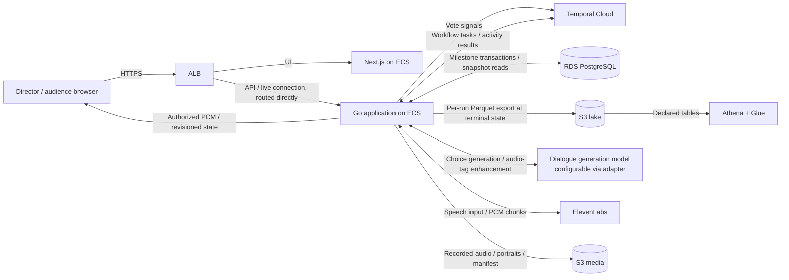

# Monster Theatre — System Design

Status: Design in progress. Requirements, room-owned characters, immutable create-and-publish, Temporal setup compensation, one Performance resource with nested components and hybrid milestone snapshots, one performance per room, concurrent performances as a configurable capacity limit, premiere playback over the room WebSocket, automatic progression without Stop controls, an AWS-hosted milestone, Temporal Cloud with Go workflows, workflow-owned voting by signal with application-side selection, terminal-state Parquet export in place of stream processing, and a configurable dialogue-generation model behind an adapter are agreed with the user. Remaining interfaces, business data flows, and the high-level architecture below are a design draft. Deep dives and final design sign-off remain outstanding.

Source of truth: [Product brief](monster-theatre-product-brief.md). Significant choices are recorded in [Decisions](decisions.md).

## 1. Requirements baseline

### Actors and core capabilities

| Actor | Capability | Successful outcome | Important failures |
| --- | --- | --- | --- |
| Director | Create and publish a room in one request, then start its automatic performance | Complete immutable scene/character setup and two validated portraits produce a shareable link and Start button; Start initiates automatic progression | Invalid input/upload, provisioning failure, unauthorized action, duplicate or conflicting Start, explicitly failed run |
| Audience member | Enter, vote, and hear each chosen turn | An anonymous session votes once per eligible round; one committed choice becomes expressive streamed speech | Late/invalid vote, blocked browser audio, delayed tally, paused synthesis |
| Audience member / director / operator | Hear the premiere and inspect saved work | Eight recordings become one uninterrupted performance after a five-second countdown; media and queryable events remain in S3 | Preparation/storage failure, incomplete run, unavailable or delayed lake records |

The director can also act as the demo operator. Operator bucket access is separate from audience room access.

### Agreed scope and invariants

- Up to ten audience sessions per performance. Rooms are independent: a run in one room never blocks a run in another, and directors do not block each other. Concurrency is bounded by a configured maximum, not by an invariant (D020).
- Each room can host exactly one performance. After completion or failure, another performance requires a new room and audience link.
- One complete setup request creates and publishes the room. There is no editable room draft, setup revision, standalone character resource, or separate publish/upload operation for the director. Any setup change requires a new room.
- Scene and character context are fixed by the creation submission and are immutable when the room becomes ready/published. Start uses that already fixed setup.
- After the initial director Start, progression and bounded retries are automatic; there are no Stop or manual retry controls.
- The first working milestone is reachable remotely on AWS. Temporal Cloud manages durable workflow execution, with Go workers hosted on AWS.
- Room owns two character components, identified only within the room as slots A and B, each with an uploaded portrait reference, name, optional brief, and a hardcoded voice. Portrait bytes remain S3 media assets.
- Performance owns eight turn components; each turn contains its one voting round and synthesis-attempt summaries. Turns, rounds, votes, and attempts have no independent CRUD resource APIs.
- Use the agreed hybrid model: Temporal owns internal execution progress, working context, and in-round vote state; PostgreSQL owns published milestone snapshots and immutable winner commitments. Persist a round's accepted votes and rejections to a separate ledger at close, without rewriting the whole Performance snapshot.
- Eight alternating turns, beginning with A's introduction and ending with B's EXPLAIN + PUNCHLINE. Middle beats are REACT or QUESTION.
- Three distinct dialogue choices and a ten-second voting window for each turn. Generation finishes before the window opens.
- One accepted vote per audience session per turn. Reconnection retains the same identity. Late joiners observe the current phase and become eligible at the next round opening.
- Order of arrival in workflow history determines eligibility. Retried submissions cannot add votes.
- A vote signals the performance workflow. The workflow owns eligibility, choice validity, duplicate suppression, and the deadline, and counts the votes it received. The application applies the most-votes rule, performs any tie-break or no-vote selection, and commits one immutable winner.
- Most votes wins; ties and zero-vote rounds use a random selection made by the application once at winner commitment, persisted with its reason and never re-rolled by replay.
- The vote signal and the round's durable timer occupy one ordered history, so a vote is counted or recorded as late by that order. Rejected submissions — duplicate, late, invalid, ineligible — are retained as inspection records.
- Audio tags preserve the selected words. Speech retries retain the winner and do not reopen voting.
- The room timeline advances independently of individual browser playback completion.
- The premiere reuses completed turn recordings. All eight recordings and assembled audio must be ready before the countdown.
- An unrecoverable run remains visibly failed/incomplete and retains available artifacts.
- Media and structured lake records are separate, private S3 content. Audience access does not confer bucket access.
- Seven-day default retention, with manual preservation for selected runs, covers associated media and structured records.

Deferred: animation, image interpretation, variable turn counts, selectable voices, microphone input, an in-app library/browser, analytics UI, and strong audience identity enforcement.

### Non-functional acceptance targets

| Concern | Agreed target or rule |
| --- | --- |
| Vote acknowledgement | p95 under 300 ms, measured to signal acceptance by the workflow service; an accepted signal is durable and survives worker restart |
| Result latency | Winner committed within one second of window closure under normal operation; the workflow already holds the votes, so **Counting votes…** is a brief transition rather than an expected wait |
| Speech latency | First audible output p95 under two seconds after submitting/flushing tagged text; measure generation and tagging separately |
| Consistency | One active turn/round per run, strict turn order, immutable winners, current state on reconnect |
| Recovery | Progression resumes within 60 seconds of a worker restart; workflow history is the replay source; durable execution does not promise exactly-once speech or browser playback |
| Lake freshness | Queryable records within 60 seconds of a run reaching a terminal state; a run in progress is not queryable |
| Degradation | Votes cannot be accepted while the workflow service is unreachable, which coincides with progression being stopped; preserve selected text on speech failure; show preparation/retry status on assembly/storage failure |
| Security | Director authentication; room-link audience access; server-held provider keys; private encrypted objects; bounded uploads/text/starts/retries |
| Browser environment | Desktop first; activate audio on Enter theatre or director Start; expose Tap to hear audio when needed |
| Operation | Track generation usage, audio latency, vote-processing lag, workflow task failures and retries, lake export failures, and synthesis failures |

These are validation targets, not verified provider or deployment guarantees.

### Decision-relevant capacity

Every figure below is **per performance**. The configured concurrency maximum multiplies all of them — listeners, bandwidth, concurrent provider connections, and generation spend — so it is a capacity decision rather than a product one (D020). The proposed default of three is provisional and belongs to the audio deep dive, which owns the fan-out measurements that should set it.

- At most 80 accepted votes per performance: eight rounds × ten audience sessions. Retries and rejected submissions add records but must not increase accepted vote totals. This workload does not justify stream-processing or read/write scaling infrastructure, which is why the earlier Flink and Kinesis components were removed (D018).
- Roughly 200 structured events per completed run across votes, rounds, turns, synthesis attempts, and playback. This is small enough that the lake can be written as one object per performance and queried without precomputed metrics.
- Each normal completed run has 24 dialogue choices, eight committed choices, and at least eight synthesis attempts. Bounded retry limits remain to be set.
- At least eleven binary media artifacts are referenced by a normal completed run: two portraits, eight turn recordings, and one assembled recording. Scripts and manifests are additional artifacts. Cross-room asset sharing is unnecessary for this milestone.
- There are ten audience listeners plus the director. Stream bandwidth, recording sizes, and storage retention footprint are deferred to the audio/media deep dive, where codecs, duration limits, upload limits, and expected runs per day can inform the estimates.

## 2. Core resources and durable records

The resource boundaries for Room and Performance are agreed. This table also names durable inspection records; naming a record does not require an independent CRUD resource or table for every concept. Detailed schemas and remaining transport choices come later.

| Entity | Stable identity / owner | Responsibility and relationships | Lifecycle | Authority |
| --- | --- | --- | --- | --- |
| Director identity | Authenticated director ID | Owns rooms and is authorized for complete setup submission and Start. A Cognito user pool is the proposed mechanism (section 5). | Managed by the chosen authentication mechanism | Authentication establishes identity; application enforces resource ownership |
| Room | Room ID; director ID | Shareable theatre owning immutable scene context, character components A/B and portrait references, audience memberships, and zero or one performance reference | Internal provisioning → ready/published or provisioning failed; no setup edits and no second run | Application for context/state; S3 for portrait bytes |
| Audience session | Session ID; scoped room membership | Anonymous voting identity restored on reconnect. Presence and connection state are distinct from identity. | Joined → disconnected/reconnected; session expiry to be specified | Application |
| Performance | Performance ID; room ID and director ID | One automatic run owning eight nested turns, their voting fields, synthesis-attempt summaries, current published phase, room playback timeline, and artifact references | Running → preparing premiere → countdown → premiering → completed; unrecoverable error from any nonterminal phase → failed | PostgreSQL for published business milestones; Temporal for internal execution |
| Accepted vote ledger record | Vote ID; scoped performance/turn and audience session ID | One eligible choice selection with its arrival order. Owned by Performance, stored outside its snapshot; duplicate/late/invalid submissions are retained as rejection records, not extra votes. | Accepted in workflow history → written to the ledger at round close; cannot be changed into a second vote | Workflow owns acceptance and uniqueness; the ledger is its durable projection |
| Media artifact | Artifact ID; linked room/performance/turn/attempt as appropriate | Portrait, turn audio, full audio, script/decisions, or manifest. Stores object reference, readiness/completeness, and preservation/expiry metadata. | Pending → ready or failed/partial → expired, subject to preservation | Application for metadata and readiness; S3 for object bytes |
| Performance event | Event ID + schema version; room/performance/turn IDs where applicable | Durable facts about votes, rejections, rounds, turns, synthesis, and playback; references artifacts without embedding media | Durably recorded at its milestone → exported to the lake at terminal state | Originating application facts; lake objects are a derived publication |

Dialogue choices belong to the round and do not need an independent lifecycle. The immutable selection belongs to that same round, including counts, chosen ID, and majority/tie/no-vote reason. Selected dialogue alone becomes story history.

Lake objects are a derived publication, not a second authority for live room state. The event schema and query contracts will be defined during the data-lake design. No precomputed metrics are stored; the demo questions are answered by query over the exported events (D019).

### Performance-owned components

```text
Performance
├── Room reference, published phase, playback timeline, final artifact references
└── Turns 1–8
    ├── Speaker, story beat, selected dialogue, tagged text, recording reference
    ├── Voting: three choices, eligibility, opening/deadline, closure, tally, winner
    └── Synthesis-attempt summaries: attempt identity, status, timings, artifact references
```

Turn number identifies a component within its performance. Each turn has exactly one voting round, so the round is a group of fields within the turn rather than an independently managed resource. Attempts likewise belong to their turn. Keep stable scoped turn/round/attempt identifiers for event correlation, idempotency, and audio delivery; those identifiers do not imply separate REST resources.

Persist one bounded Performance snapshot containing its nested turn data and committed tallies. Enrich the authorized response with the viewer's receipt from the separate ledger. The workflow enforces one vote per performance/turn/session; the ledger carries a matching uniqueness constraint only as a backstop. Do not persist a viewer-specific receipt into the shared snapshot, rewrite it for each accepted vote, or expose other audience members' receipts/identities.

Detailed provider-attempt events and audio artifacts remain durable even when only summaries are nested in the snapshot. Temporal activity retry metadata supports execution recovery; explicit synthesis events still provide provider usage, first-audio latency, failure details, and partial-artifact inspection. Each synthesis event also carries its speaker/voice and story beat, so first-audio latency can be grouped by either without joining back to turn state. This does not require an independent attempt resource or one SQL row per attempt.

### Hybrid state ownership and database calls

| State | Owner / storage | Database interaction |
| --- | --- | --- |
| Immutable room context and turn schedule | Load Room once at performance startup; carry its small context through Temporal workflow input/state | Initial read, then pass context to activities instead of re-reading Room per stage |
| Current internal step, timers, result waits, retries, selected dialogue history | Temporal deterministic workflow state and recorded activity results | No SQL read/write for every internal assignment or timer |
| Generation/tagging results and ordered audio references | Temporal working state; retain required inspection facts in durable events/artifacts | Publish choices once at round opening; combine other persistence with relevant milestones/events rather than independent entity updates |
| Published voting state and committed winner | Nested PostgreSQL Performance snapshot | Persist opening and one immutable result commitment; include corresponding event writes in those transactions |
| In-round vote state: who has voted, which choice, what was rejected | Temporal workflow state and history | None during the round; a vote costs a signal, not a database write |
| Accepted vote and rejection records | Separate ledger, written at round close | One transaction per round carrying that round's accepted votes, rejections, counts, and result; no full Performance snapshot rewrite |
| Playback anchors, turn completion, premiere readiness, terminal outcome | PostgreSQL Performance snapshot plus referenced S3 artifacts | Milestone transactions, not writes per audio chunk |
| Audio bytes and detailed artifact content | S3; bounded in-memory delivery buffers for live chunks | No SQL or workflow-history audio payloads |

Temporal working state is recovered from recorded input, activity outcomes, and replay-safe decisions; it is not an ordinary process-memory cache. SQL remains authoritative for externally published state and committed choices, and workflow state carries those persisted outcomes forward. [Temporal event history](https://docs.temporal.io/workflow-execution/event).

Use these persistence boundaries: Start, with its capacity check; round opening; round close, which carries that round's votes, rejections, counts, and committed winner in one transaction; playback anchors and completed turn recording; premiere readiness/timeline; completion or terminal failure; lake export. At each, update the snapshot where applicable and append its durable events in the same transaction. Provider attempt facts still need durable inspection events around side effects, but not separate Turn/Round/Attempt CRUD writes.

Votes do not touch the database while a round is open. They signal the workflow, which holds the published choices, the eligible session set, and the set of sessions that have voted, and which decides eligibility, validity, duplication, and lateness from that state. Reconnect and published-state reads still use the latest snapshot and do not require a live workflow worker. Published snapshots describe meaningful product phases; they need not expose every private generation/tagging/retry substep. The live state and room timeline can reflect the last durable milestone while workers recover; recovery must never invent newer state or roll back a committed result.

One consequence is worth stating directly: during an open round, a reconnecting client cannot learn whether its own vote registered by reading PostgreSQL, because the ledger has not been written yet. A client treats its own accepted submission as provisional and receives the authoritative per-session outcome when the round closes. If that proves insufficient in practice, a workflow query scoped to the current round is the fallback, but it is not part of this design.

This keeps database calls proportional to product milestones rather than to audience activity: a round costs two transactions regardless of whether it received zero votes or ten. It does not eliminate durable storage — Temporal writes execution history, and the event records still persist every replayable fact. Exact snapshot columns, event schema, and representation remain implementation choices consistent with these boundaries.

Required acceptance scenarios: a Performance read returns authorized nested turn/voting/attempt data; a duplicate vote produces one accepted ledger entry plus one rejection record; published-state reads still work while a workflow worker is unavailable; a vote signal accepted during a worker outage is still counted once workers return; recovered activities return the same committed winner; workflow recovery preserves room context and selected dialogue history; provider-attempt failures remain inspectable through events/artifacts; streaming audio produces no per-chunk SQL snapshot writes.

### Room-owned setup and dialogue context

Room is the resource boundary for the director's complete setup:

```text
Room
├── Scene: topic, optional description, optional genre
├── Character A: name, optional brief, portrait reference, fixed voice
└── Character B: name, optional brief, portrait reference, fixed voice
```

Characters are components of Room, not independently managed entities. Slots A/B are sufficient identity within a room; there are no standalone character IDs, lifecycles, or CRUD APIs. Database embedding versus child tables is a storage choice that does not change this ownership.

GetRoom returns all static scene/character context together, with portrait references or authorized delivery URLs rather than image bytes. Dialogue generation assembles that immutable room context with the performance's previously selected dialogue, scheduled speaker/beat, and remaining turns. Rejected choices do not become story history. Images remain portraits, not automatically interpreted generation input.

Start does not freeze or revise setup: the submitted context is already fixed, and successful create-and-publish makes it ready for audience admission and Start. Export the room context in the performance's saved script/manifest for standalone inspection; this does not create another editable setup resource.

### Relationships and ownership boundaries

- A director owns rooms; each room has exactly two character slots and room-scoped audience memberships.
- A ready/published room starts at most one performance; each performance references its already immutable room context and owns eight ordered turns. Failure does not restore the room's ability to Start.
- Each turn has one round, three choices, up to ten accepted votes, and zero or more synthesis attempts.
- Each completed turn references exactly one selected completed recording. Failed attempts remain inspectable but are not substituted into the premiere.
- The complete recording and manifest belong to the performance; the manifest links frozen portrait references, ordered turn recordings, and their timing.
- Events connect these entities through stable IDs; retries and replay preserve original fact identities.
- Preserving a performance must preserve its room-owned portraits and associated structured records, not merely its manifest. Cross-room asset sharing is deferred.

### Lifecycle rules that affect later interfaces

1. Create-and-publish must complete room provisioning and both room-owned portrait writes before issuing the shareable link. Start requires that ready state, admits the run only if the count of performances in non-terminal phases is below the configured maximum, and enforces at most one performance for the room. A Start refused for capacity leaves the room startable; only a successful Start consumes its one run. Concurrent or retried creates/starts cannot create extra rooms/runs for the same idempotency key.
2. A published room can admit observers while a run is active. New membership during an open round does not create eligibility in that round; reconnecting an already eligible session restores its existing eligibility.
3. A round opens only after three valid choices exist. Its eligibility set is fixed at opening, and its deadline is a durable workflow timer started at that point.
4. A vote is durable once the workflow service accepts its signal, before any worker processes it. Whether it falls inside the round is decided by its position relative to the round's timer in workflow history, so a vote is counted or recorded as late — never acknowledged and then dropped, and never admitted after the timer has fired. Worker unavailability delays processing without changing membership.
5. The winner is committed once, before enhancement/synthesis. The application makes any tie-break or no-vote selection at that commit, which is the only point randomness is applied; a retried or replayed commit returns the persisted choice rather than producing a second selection.
6. Tagging/speech failures pause the current stage and trigger bounded automatic retries with visible status. Completed rounds are never reopened. Retain the chosen words; a failed speech attempt gets a new attempt identity rather than a new vote result.
7. Streaming and playback can overlap. A turn completes only once its recording is complete and its playback interval has ended on the room timeline. The exact timeline/recovery contract remains open.
8. Exhausted recovery makes the run terminally failed, cancels unfinished progression, and prevents late worker results from starting further playback or changing terminal status. Retain partial artifacts and relevant events; do not label the run completed. Recovery budgets/deadlines remain to be set.
9. Premiere preparation failure keeps the run in preparation with visible automatic-retry status until recovery succeeds or its budget is exhausted. Start the five-second countdown only after all required recordings and complete playback are ready.
10. Completion and artifact readiness are separate from lake visibility. Reaching a terminal state triggers the lake export; a successful premiere does not imply the export has already landed.

### Core-entity checkpoint outcome

The user chose **room-owned characters**, **immutable create-and-publish**, **one Performance resource with nested components and hybrid milestone snapshots**, **one performance per room**, and **automatic progression with no Stop controls**. Setup changes and subsequent runs require a new room and link. See D005, D007, D013–D016.

Every core capability now maps to identified entities with logical ownership. Proceed to interface design; physical stores and schemas remain open.

## 3. Proposed actor interfaces

Use resource-oriented HTTP commands/queries as the proposed baseline. This section defines behavior; the proposed services and realtime transport are in section 5. `/api/v1` is a proposed route prefix, not an existing implementation.

### Director commands and queries

Every operation requires verified director identity and ownership of the target room. Derive owner identity from authentication, never from request-supplied director IDs. Start is the only performance action; all subsequent progression and retries are automatic.

| Operation | Essential request / response | Validation, concurrency, and errors |
| --- | --- | --- |
| `POST /api/v1/rooms` | One `multipart/form-data` request containing scene/character JSON and portraits A/B, plus an idempotency key → `201` with room ID, ready status, and shareable audience link | Require complete valid setup; authenticated director; finish provisioning before success; retries recover the same operation/result, not another room |
| `GET /api/v1/rooms/{roomId}` | No body → director room snapshot including all static scene/character context | Snapshot includes room readiness, current performance phase/revision, legal Start action, and safe error status; no provider credentials |
| `POST /api/v1/rooms/{roomId}/performance` | Idempotency key → `202` with performance ID and current phase | Ready/published, never-started room only; `429` when concurrent performances are at the configured maximum, which is retryable and leaves the room startable; use already immutable context; same-key retry returns the existing run, different Start after creation returns `409` |

There are no room-edit, separate publication, standalone character, or portrait-replacement APIs. The director submits once, then sees the shareable link and Start button. A form can be edited locally before submission; there is no server-side editable draft.

Idempotency keys are scoped to caller and operation, and to a resource where one already exists. For creation, persist the submitted context and portrait-content fingerprint so retries can recover the same operation; reusing a key with different inputs is a conflict. Phase revisions still protect runtime state transitions, not setup edits. Exact key expiry and retry budgets remain implementation-level choices unless recovery analysis requires stronger constraints.

The create handler waits for setup readiness before returning the link. An HTTP timeout or disconnect does not cancel a durably handed-off setup workflow or trigger compensation. Retrying the same submission/key recovers its current operation or completed response. Never report provisioning as successful while portraits or publication are incomplete.

### Performance snapshot query

`GET /api/v1/performances/{performanceId}` returns an authorized nested Performance view: published phase/revision, current turn, voting fields/committed results, selected dialogue, safe attempt summaries, playback anchors, and authorized audio references. Allow the owning director or an audience session scoped to its room. Include only the caller's voting eligibility/receipt; do not expose other audience identities, provider credentials, or raw provider errors.

Read the persisted milestone snapshot and the caller's receipt without querying Temporal. During an open round the caller's receipt is not yet in the ledger, so this view reports the round as open without per-session vote state; the state channel carries that. Room reads continue to supply static scene/character setup and current performance identity/state for the theatre. No independent Turn, VotingRound, AcceptedVote, or SynthesisAttempt CRUD/read endpoints are required; nested snapshot data and the voting command cover the MVP.

### Audience commands and queries

The share link carries an opaque room-access capability, not director or bucket permissions. Exchange it on Enter theatre for a room-scoped session credential. Browser Enter theatre also activates local audio; server admission cannot itself guarantee autoplay permission.

| Operation | Essential request / response | Validation, identity, and errors |
| --- | --- | --- |
| `POST /api/v1/audience-sessions` | Room-access capability; existing session credential if reconnecting → room/session identity and current snapshot | Invalid/expired capability rejected; reconnect reuses identity; enforce ten admitted audience sessions; new session during an open round is eligible from the next opening |
| `GET /api/v1/audience/rooms/{roomId}` | Room-scoped session credential → current audience snapshot | May view only its room; no accepted-voter list, director controls, raw capabilities, or bucket access |
| `POST /api/v1/performances/{performanceId}/turns/{turnNumber}/votes` | Choice ID + submission idempotency key → `202` with the submission's identity | Identity comes from session credential. The handler authenticates the session and its room scope, then signals the performance workflow; it does not read round state first. Synchronous failures are limited to `401`/`403` on the credential and `409` when the run has already finished, leaving no workflow to signal. Eligibility, choice validity, duplication, and lateness are decided by the workflow and surface over the state channel |

The vote endpoint is asynchronous by design. Accepting a signal is itself durable — the workflow service persists it before the call returns — so a `202` means the vote is recorded and will be processed, not that it was counted. The outcome arrives on the client's existing state subscription, which it is already using to follow the round.

The first valid vote is final: one vote per session per round means no vote-changing operation. A resubmission of the same choice is absorbed by the workflow's per-round voted-session set and produces one accepted vote. A different choice from a session that has already voted is recorded as a duplicate rejection and does not replace the first.

Acceptance and the deadline do not race. The vote signal and the round's durable timer are events in one ordered workflow history, so a vote is either ahead of the timer and counted, or behind it and recorded as late. There is no window in which a vote is acknowledged and then excluded, and no clock comparison between two systems.

Disconnection alone does not release identity or an audience slot; otherwise reconnecting could create duplicate voters. Session lifetime/admission cleanup remains to be specified without adding a device-identity guarantee.

### Live state and audio contracts

These are logical interfaces; the proposed realtime and audio transport is described in section 5.

- **Subscribe to room state:** verified room audience or owning director receives revisioned phase updates. Updates include performance/turn IDs, speaker, open-round choices, server deadline, own voting eligibility/receipt, committed selection/tally, preparation/error status, and room timeline anchors as relevant. Tallies are revealed after commitment in this draft.
- **Reconnect/resynchronize:** receive a current snapshot and newer updates without a gap. Missing historical messages must not force clients back into an earlier phase. Sequence/revision values distinguish stale updates from current state; clients recover through a snapshot when needed.
- **Receive turn audio:** authorized clients receive ordered arriving audio associated with performance, turn, and synthesis-attempt identity. Distinguish streaming bytes, final recording readiness, provider failure, and room playback progression. Old attempts cannot supersede the selected attempt.
- **Receive premiere playback:** only after preparation succeeds, publish complete playback availability and a server timeline for 5, 4, 3, 2, 1 and the premiere. The assembled recording is delivered as ordered audio chunks over the same connection that carried the live turns, on the server's room timeline, using the same sequence identification and snapshot-resync rules. A client connecting or reconnecting during the premiere resumes at the timeline's current offset rather than starting the performance again. Audience sessions receive no object URL for playback, so a room link grants no S3 access of any kind.
- **Failure/recovery notification:** expose automatically retrying versus terminally failed state. Terminal failure invalidates queued phase/audio work; clients clear playback associated with invalidated attempts. No director action is required or offered.
- **Playback telemetry:** any first-audible or playback-blocked reports are observational, attributable to a session and attempt, and cannot advance the room or change a winner. The exact ingestion interface and metric definition belong to the audio deep dive.

The director subscribes to the same authoritative room progression. Browser-local blocked/buffering/disconnected status is distinct from the room's phase. No Stop or manual retry interface is exposed.

### Visible failures and proposed validation bounds

Use structured failures with a stable code, human-readable message, retryability, and current revision/phase when useful. Baseline HTTP outcomes: `401` absent/invalid credentials, `403` unauthorized role, `404` inaccessible resource, `409` conflicting state/idempotency or a vote for a run that has already finished, `413` oversize upload, `422` invalid fields/media, and `429` bounded admission/control/retry limits.

Proposed starting limits, subject to audio/provider validation:

| Input | Draft bound |
| --- | --- |
| Portrait | JPEG, PNG, or WebP; up to 5 MiB and 4096 × 4096 pixels; validate decoded content; no animated image |
| Character name | Required in creation request; 1–80 Unicode code points after trimming |
| Character brief | Optional; up to 400 code points |
| Scene topic | Required in creation request; 1–200 code points |
| Scene description | Optional; up to 1000 code points |
| Genre | Optional; up to 80 code points |
| Generated dialogue choice | 1–300 code points; three distinct valid choices before opening voting; reject/regenerate/fallback within bounded attempts |

Character count bounds limit inputs but do not guarantee speech duration. Tagged-text validation, exact provider payload limits, and the timeline's duration policy remain part of the audio/provider deep dive. Do not expose raw provider failures or credentials in user errors.

### Interface checkpoint outcome

The user removed Stop controls and requested automatic flow. Keep the initial Start from the agreed journey; automate every subsequent stage and bounded retry. Setup uses a single complete create-and-publish request. Performance reads expose nested components, and the voting command is scoped to a performance/turn; separate round/attempt CRUD interfaces are unnecessary. The voting command is asynchronous: it signals the workflow and returns `202`, with outcomes delivered over the state channel. See D007, D014–D016, and D018.

## 4. Business data flows

These sequences establish business ownership, ordering, and failure behavior. They name the stores and workflow engine already agreed (PostgreSQL, S3, Temporal); the remaining components are proposed in section 5.

### Room setup and admission

1. Director submits complete scene/character context and portraits A/B in one authenticated multipart request with an idempotency key. Validate both files and all required inputs before provisioning effects. Associate the submission with a durable creation identity and input fingerprint.
2. The API stages validated portrait bytes in private S3 storage and durably hands off setup intent to Temporal using the creation identity and object references. Raw image bytes do not enter workflow history. Staging must also be recoverable/cleanable if the API fails before workflow start.
3. The setup workflow creates an internal `provisioning` Room with immutable context, copies both portraits to deterministic room-owned keys, and verifies readiness. Activities are idempotent; a crash/retry reconciles existing state and objects rather than creates duplicates.
4. In one PostgreSQL transaction, mark the Room `ready` (published), persist final portrait references and one audience-link token, and record the readiness event. No audience admission, Start, or successful creation response is permitted before this commit.
5. The original create request returns `201` with room ID and shareable link after readiness. The director sees that link and Start. Delete staging objects afterward; staging cleanup failure does not revoke a ready room. HTTP response loss does not undo publication; the same-key retry returns the existing link.
6. Enter theatre admits or restores a room-scoped audience session and returns current state. The browser activates audio locally. New sessions during an open round wait until the next round to vote.
7. Start checks concurrent capacity and creates the room's only Performance snapshot using already immutable setup, in one transaction so two simultaneous Starts cannot both pass a check that only one should. Acknowledge only after that state and recoverable workflow-start intent are durable. A retry returns the same result. Load Room context once for the workflow and carry it forward with the turn schedule.

### Setup compensation and recovery

The setup workflow is separate from the performance workflow. Its publication transaction is the setup success boundary; this flow is not a cross-system atomic transaction.

- On an unrecoverable setup failure before readiness, reconcile any ambiguous database commit first. If the Room is already ready, return its existing link and do not compensate successful setup.
- For definitively failed provisioning, transition it to failed so late attempts cannot publish it, delete room-owned portrait objects belonging to that creation, and clean its staging objects. Retain enough failed-operation metadata to diagnose/recover the submission; failed provisioning is not an editable draft.
- Register compensations before effects that might succeed despite a timeout. Deletion and failure transitions must be idempotent and conditional on the matching creation identity. Compensations have their own retries; cleanup failure must remain visible to operators and be picked up by reconciliation.
- Track staged objects against durable creation intent and expire/reconcile abandoned staging from failures before workflow start. Do not let staging expiry race an active setup operation. Reconcile late/orphaned copy results as well as missing metadata.
- A ready Room's setup is immutable. Any requested context or portrait change is a new creation with a new idempotency key, room ID, and link.
- A later performance failure retains the ready Room, portraits, and performance artifacts for inspection. It never triggers setup compensation.

Required setup acceptance scenarios: valid single-submit returns a ready room/link with both S3 portraits; missing/invalid data returns no usable room; a failed second portrait copy compensates the first; worker restart recovers the same creation; a lost response and same-key retry return the original link; changed input with the same key conflicts; ambiguous publication success is reconciled without deleting ready assets; failed cleanup is retried/reconciled; setup cannot be edited and failed/incomplete provisioning cannot Start.

### One turn, repeated eight times

1. **Generate choices:** Temporal uses the immutable Room context loaded at startup plus its selected dialogue history, scheduled speaker/beat, and remaining turns to invoke a generation activity. Validate three distinct lines; use bounded retries and a valid fallback. Carry valid results into the opening activity; rejected choices never enter story history. No Room/history database re-read or independent Turn write is needed per generation step.
2. **Open round:** in one milestone transaction, persist the turn's voting fields in the nested Performance snapshot: immutable choice IDs/text, eligible session set, opening time, and the ten-second deadline, together with its events. Notify clients after durable commitment, then start a durable workflow timer for the deadline. The workflow keeps the choices and eligible session set in working state as the authority for admitting votes. Replayed work returns the same published round rather than creating another.
3. **Accept votes:** the API authenticates the session and signals the workflow; it performs no database write and no round-state read. The workflow classifies each signal against its in-round state as accepted, duplicate, invalid, or late, and holds accepted votes and rejections in workflow state until the round closes. Nothing is written to PostgreSQL while the round is open, so ten votes cost ten signals and zero transactions.
4. **Close round:** the durable timer fires. Signals arriving after it are classified as late and retained as rejection records rather than discarded. The workflow counts the accepted votes it holds — the set is complete by definition, since it is the set the workflow itself admitted — and hands the counts, the accepted votes, and the rejections to the commit activity. No external system needs to agree that the round is complete.
5. **Commit selection:** one activity applies the most-votes rule and, only when counts are tied or empty, performs the random selection through a replay-safe side effect. In a single transaction it persists that round's accepted votes and rejection records to the ledger, the counts, the one majority/tie/no-vote selection and its reason, and the result event, then returns the durable outcome to the workflow. The commit succeeds only if no result exists yet for that performance and turn, so a retried activity returns the persisted choice instead of selecting again. This commit is the only point at which randomness is applied, and the only database write the round required besides its opening. Show Counting votes… from closure until the result commits.
6. **Enhance tags:** an activity uses the immutable winning text carried by Temporal to generate delivery tags and validates preservation of its words. Carry tagged output in workflow state; retain original/tagged text in durable synthesis events/artifacts and the turn's published summary as appropriate. A standalone tag-stage SQL snapshot write is not required. Retry automatically within a budget; final fallback policy remains to be validated against the chosen model/provider.
7. **Synthesize, stream, and record:** coordinate a distinct identified provider attempt through activities, submit tagged text to ElevenLabs, relay ordered chunks to authorized listeners, and record the same attempt audio. Persist required attempt/timing/error events, playback anchors, and final artifact readiness; keep audio chunks out of SQL/workflow history. Retry a failed attempt automatically without reopening voting; interrupted partial playback and replacement-attempt timing are an audio deep dive.
8. **Complete turn:** after complete recording readiness and the end of the room playback interval, commit its nested dialogue/tagged-text/attempt summary, selected recording reference, timing, and completion event as a milestone, then automatically schedule the next turn. Individual browser completion/telemetry cannot block this transition. After turn eight, enter premiere preparation instead.

Each automatic stage requires recoverable intent and an identity that makes recovered work distinguishable from new work. Temporal records internal orchestration and activity results; database milestone transactions and durable events cover published truth and side effects. Do not mirror every workflow-local state change into SQL. This does not imply exactly-once external generation.

### Premiere and completion

1. Verify eight completed selected recordings, then assemble them in speaker/turn order without regenerating speech. Persist complete audio, script/decisions, and a manifest linking setup, originals, recordings, and timing. Repeated preparation reuses ready inputs/outputs rather than creates another performance.
2. Retry assembly/storage failures automatically and expose preparation status. Do not start countdown while any required recording/full playback is missing.
3. Persist the server countdown/playback timeline and notify clients. Count down five seconds, then stream the assembled recording uninterrupted on that timeline, over the same connection that carried the live turns. Because the server drives position, every listener hears the same moment at the same time, and a client that connects or reconnects mid-premiere resumes at the current offset rather than restarting the performance or the voting sequence.
4. At the room timeline's premiere end, mark the performance completed and export its events to the lake. The room remains permanently used. Completion does not promise every browser heard every byte. Reaching a terminal phase is what frees concurrent capacity, since capacity is counted from phase rather than held as a claim.
5. If an essential stage exhausts its recovery budget, mark failed, invalidate pending progression, retain available artifacts, and export the events accumulated so far. A performance whose last durable milestone is older than a configured staleness budget reaches the same terminal state through an automatic sweep, so a run that stops progressing without reporting failure cannot occupy capacity indefinitely. The sweep is automatic and exposes no control surface, consistent with D007. A fresh attempt at the product journey requires a new room. Exact budgets/deadlines are still proposed design parameters.

### Inspection, lake output, and retention

1. Schema-versioned events are written to PostgreSQL in the transaction of the milestone that produced them, carrying stable room/performance/turn/attempt/event identities. They are durable from that moment; publication to the lake is a later, separate step.
2. When the run reaches a terminal state — completed or failed — an activity reads that performance's events and writes them as one Parquet object under a date partition in the lake area. A single-object PUT is atomic, so an object is either absent or complete and no checkpoint or finalization protocol is needed. The activity retries like any other; an export that never succeeds leaves a finished run missing from the lake, so export failure must be visible to the operator.
3. The query tool reads exported objects. A run in progress is not queryable, and lake delay alone must never rerun speech or affect room progression.
4. The operator uses private S3 access to inspect/download media, script, and manifest; audience sessions receive only authorized playback delivery. Preservation is an operator operation, not an audience control.
5. Apply seven-day expiry to related media and structured data unless a run is preserved. One object per performance means expiry and preservation act on whole runs, so a preserved run can be retained without rewriting a shared partition file.

### Data-flow checkpoint outcome

All three core capabilities now have end-to-end business paths. The user chose an AWS-hosted first milestone and Temporal Cloud with Go workflows, then removed Flink and Kinesis in favour of workflow-owned voting and a terminal-state lake export. See D008, D009, D018, and D019.

## 5. Proposed high-level architecture

### Recommended baseline

Keep one Go application responsible for business state, HTTP, live delivery, and Temporal activities. Use PostgreSQL for authoritative state and its transactional event log, and export that log to the S3 lake in a batch when a run finishes. Temporal owns in-round voting state and all progression. Do not split into independently owned microservices for this workload, and do not introduce a streaming pipeline for a workload of eighty votes.

| Component | Proposed role | Why it is needed |
| --- | --- | --- |
| Next.js web frontend | Director setup and audience theatre, static portraits, controls, voting, audio player | Preferred web stack and the agreed browser experience |
| Application Load Balancer + ECS Fargate | HTTPS ingress; containerized Next.js and Go runtime | AWS hosting for invited users; long-lived browser/provider streams |
| Go application | APIs, authorization, room state, vote signalling, live audio fan-out, lake export, and Temporal worker | Preferred backend; keep one business-state authority |
| RDS PostgreSQL | Room/session metadata, one Performance milestone snapshot with nested turn/voting/attempt summaries, accepted-vote and rejection ledger written at round close, durable events, artifact references | Immutable published commitment and snapshot reads during worker recovery |
| Temporal Cloud | One setup workflow per creation for provisioning/compensation; a separate workflow per performance for durable timers, vote signals and in-round voting state, activities, retries, eight-turn progression and finale | Accepted engine for recoverable setup and automatic performance; headline learning objective, and the authority for voting under D018 |
| Dialogue generation model (configurable) | Two calls per turn: generate three distinct dialogue choices, then enhance the winning line with audio tags without changing its words. Reached through one narrow application-side adapter; endpoint and model identifier come from configuration, not code | Every turn depends on it twice; D017 keeps the model swappable per environment and records the model used on each attempt |
| ElevenLabs | Expressive speech synthesis for each committed turn, streamed to the Go application as it is generated | Core learning objective; the source of all performance audio |
| Private S3 media bucket | Private setup staging and room-owned original portraits; immutable attempt/turn recordings, full audio, script/decisions, manifest | Recoverable portrait provisioning, exact recorded replay, and preserved inputs |
| Private S3 lake bucket | One Parquet object of structured events per performance, under a date partition, written at terminal state | Queryable historical data without media payloads; per-run objects keep expiry and preservation independent |
| Athena + Glue Data Catalog | Operator SQL inspection of exported Parquet using a declared schema and partition projection | Agreed lake inspection; partition projection avoids running a crawler |
| Cognito user pool | Director login; administrator-created users, no public signup | Limited director access without implementing a password system |
| Secrets Manager, IAM task roles, CloudWatch | Provider/Temporal credentials, scoped AWS access, operational logs/metrics | Server-side keys and observable recovery/latency |

Physical region, resource sizes, availability configuration, and estimated recurring cost remain open. Start with one active application task for the demo; this deliberately prioritizes simplicity over seamless stream failover. Durable state survives task replacement, but in-flight audio may be interrupted.

That single task is also what the concurrency maximum is really bounding. The fan-out estimates below were sized for the eleven listeners of one performance; three concurrent runs triple both the delivery load on the task and the number of simultaneous provider connections. Measure that before raising the default, and treat the task's fan-out headroom — not a product rule — as the number that sets it.

A vote signal is persisted by the Temporal service before the call returns and does not require a worker to be polling; a workflow query would, which is why the vote path signals without first checking round state. [Sending messages to workflows](https://docs.temporal.io/sending-messages). Athena reads Parquet using catalog metadata. [Athena data sources](https://docs.aws.amazon.com/athena/latest/ug/work-with-data-stores.html). Cognito can disable self-registration. [Cognito user creation policy](https://docs.aws.amazon.com/cognito/latest/developerguide/user-pool-settings-admin-create-user-policy.html).



### Responsibility and transaction boundaries

- **PostgreSQL is authoritative for published business state; Temporal is authoritative for in-round voting.** Enforce one room creation per director/idempotency key, one performance per room, and one result commitment per round through constraints. Concurrent-performance capacity is not an invariant and holds no lock: Start counts performances in non-terminal phases inside the transaction that creates the new one, so there is no claim to release and nothing to leak if a run never reaches a terminal state. One accepted vote per round/session is enforced by the workflow's voted-session set rather than by a constraint, and the ledger written at close carries a matching uniqueness constraint as a backstop. Setup is immutable; phase revisions protect runtime transitions. External calls run outside database locks.
- **Atomic milestone state and events:** externally meaningful milestone updates commit their snapshot and event records together. A round costs two transactions — opening, and the close that persists its votes, rejections, counts, and winner. Workflow-local assignments, in-round votes, and audio chunks need no database transaction. Creation records recoverable intent to start setup workflow `room-setup/{creationId}` once staging is ready; Start records intent for the separate workflow `performance/{id}`. Recovery reuses existing workflow identities and never creates a second room or run. Room readiness and its link token commit atomically after portraits are ready.
- **Temporal owns internal execution and voting; PostgreSQL owns published milestones.** Workflow code carries room context, selected dialogue history, in-round vote state, generation/tagging outcomes, ordered artifact references, timers, waits, and retry coordination. Activities perform database/provider/S3 I/O, reuse completed outcomes, and conditionally commit milestones or side-effect facts. Reconnect and published-state reads go to PostgreSQL directly, without a workflow query. Keep media bytes out of workflow history. This follows [Temporal's durable timer model](https://docs.temporal.io/develop/go/workflows/timers) and [event-history recovery](https://docs.temporal.io/workflow-execution/event).
- **The winner commitment is the one point of randomness, and it is insert-once.** The commit activity writes the result only if none exists for that performance and turn, so an activity retry after a partially observed commit returns the persisted choice rather than selecting again. Randomness comes from a replay-safe side effect, never from a direct call in workflow code.
- **The lake is a publication, not a pipeline.** Export reads committed events and writes one immutable object per performance. It cannot influence live state, and a failed export never affects a run's outcome — only its visibility to queries.
- **S3 and database updates converge.** Upload immutable attempt-specific objects, then conditionally mark readiness after successful storage. Recovery can reconcile an existing object before uploading again. Unselected/partial attempts cannot become the premiere's recording.

### Realtime and audio direction

Propose one same-origin WebSocket carrying three things — revisioned room-state messages, live turn audio, and premiere playback — while setup and votes remain ordinary HTTP. This departs from the pattern's SSE default for one-way state because binary audio shares the connection without text/base64 framing. Using it for the premiere as well as the turns keeps one player, one buffering model, and one notion of position in the browser. Authenticate on connection and authorize its room; use heartbeats, bounded buffers, attempt/sequence identifiers, and snapshot recovery. Do not run websocket traffic through a response-buffering frontend handler; route its path directly to Go at ingress.

Since the initial Go runtime also owns synthesis and fan-out, there is no additional audio-routing broker. Durable room revisions can be read/replayed from PostgreSQL. In-memory connection maps/chunk queues are delivery state, never vote or performance truth. Slow clients resynchronize rather than blocking the provider or retaining unbounded buffers.

Propose ElevenLabs Text to Dialogue over a backend WebSocket with `eleven_v4`, both fixed voices registered, explicit turn boundaries/flush, and keep-alive through generation/voting gaps. The provider's guide distinguishes multi-voice `eleven_v4` from one-voice-per-connection turbo and documents a 20-second inactivity timeout. [Realtime dialogue guide](https://elevenlabs.io/docs/eleven-api/guides/how-to/websockets/realtime-tdd).

Propose 24 kHz mono 16-bit PCM after confirming account/output support. This simplifies frame indexing, turn recording, and concatenation into a valid WAV premiere without regenerating speech or concatenating encoded-file headers. Provider final-turn signaling must be validated with a real request; its API recommends PCM where exact boundaries matter. [Dialogue WebSocket API](https://elevenlabs.io/docs/api-reference/text-to-dialogue/ttd-websocket). Audio tags/voice IDs/model availability and the browser AudioWorklet path require a provider/browser spike before implementation assumptions are finalized.

Illustrative capacity at that proposed format: 48,000 bytes/second per listener; eleven listeners consume about 0.53 MB/second of audio payload. Assuming 15–30 seconds per turn, selected turn audio totals 5.76–11.52 MB; storing both individual recordings and the assembled premiere approximately doubles that, before portraits/failed attempts. These are estimates, not a speech-duration guarantee.

Because the premiere streams back through the application rather than from S3, each performance sends its audio to every listener twice — once live, once at the premiere — so container egress is roughly double the figure above, and multiplies again by the concurrency maximum in D020. One small container is still plausible for fan-out at this scale; benchmark against the latency target and that doubled figure before selecting its size.

Receive both small portraits in the single authenticated multipart create request and validate them in Go: proposed bounds are two 5 MiB images per room. Stage bytes privately before passing only their references to Temporal; copy them to immutable room-owned keys before publication, and reconcile abandoned staging. Live audio already passes through Go to record exactly what it streams, and the premiere streams back through it the same way. Short-lived per-object authorized URLs therefore cover portraits and operator inspection or download of media, script, and manifest — not playback. No audience session receives an object URL at any point, so the rule that a room link grants no bucket access holds without qualification. Direct browser-to-S3 upload/CDN infrastructure is unnecessary until measured transfer load justifies it.

### Remaining deep dives

Removing Flink closed most of what the first draft named here. The vote receipt, completeness, and result-delivery deep dive is gone entirely: its contents were the admission/closure race, replay retention, JDBC flush configuration, and the mechanism by which a commit activity learns counts have landed. Under D018 the workflow holds the votes it admitted, so completeness is definitional, there is no stream to retain or replay, and there is no result to deliver across a system boundary.

1. **Audio timeline and interrupted attempts.** Define first-chunk buffering, authoritative sample/time anchors, provider underrun handling, slow/reconnecting browser behavior, automatic speech retry after partial audible output, and task replacement. Premiere transport is settled — the assembled recording streams over the room WebSocket on the server timeline, and a reconnect resumes at the current offset — so what remains there is buffering and anchor behaviour, including how much a resuming client is sent before it can play. The simplest proposed interrupted-attempt policy restarts the same selected line in a fresh attempt and visibly resets that turn's playback; only the completed elected attempt enters the premiere. This can repeat a partial line and must be accepted as a tradeoff. Vote and tag decisions remain fixed. This is now the only substantial deep dive, and it carries the unresolved PCM-output question from D012 with it.
2. **Lake schema, retention, and preservation.** Define the event schema and its versioning, the partition layout and Athena partition-projection configuration, the per-performance object naming, and the deletion/preservation procedure. Confirm that each example demo question maps to fields that are actually recorded — in particular that synthesis events carry first-audio timestamp, speaker, and story beat, and that rejected submissions are recorded with their reason. Export mechanics themselves are simple; the schema is the part worth designing before writing data that becomes awkward to change.

### Language and framework choices

The project is Go and TypeScript. The Java-versus-PyFlink question in the first draft is moot: there is no Flink job, so there is no third language and no connector-compatibility testing. Next.js, Go, PostgreSQL, and AWS follow the preferred stack. Temporal Cloud is an accepted exception to an entirely AWS-managed control plane. Encore is not assumed: its infrastructure simplification must outweigh integrating explicit AWS services and raw audio streaming before introducing it. A direct LLM-call adapter is sufficient for generation/tagging, with the endpoint and model identifier supplied by configuration so a model can be substituted without a code change (D017); no agent framework or separate Python service is currently justified.

### Architecture checkpoint

The baseline traces setup/admission, durable voting, streamed speech, premiere, and lake inspection end to end. Proposed components remain reviewable choices; no resources have been provisioned.

Material unresolved items: AWS/Temporal region and recurring-cost envelope, PCM output availability on the speech provider's dialogue WebSocket, interrupted speech/reconnect behavior, exact retry/deadline budgets, the lake event schema, and lake preservation/deletion. These must be resolved before design sign-off and the implementation plan.

Resolved since the first draft: the vote receipt and completeness contract, which dissolved when voting moved into the workflow (D018); the counts-versus-selection split, carried forward from D002; the lake write mechanism (D019); and the generation provider, now a configuration concern behind an adapter rather than an architectural choice (D017). Removing Flink and Kinesis also removed the Java toolchain, managed-Flink VPC networking with its NAT or VPC endpoints, checkpoint tuning, and the outbox relay — the largest single reduction in moving parts since the first draft.

## 6. Remaining design stages

1. **Deep dives:** resolve the two ranked issues above and their measurable acceptance checks; settle provider/region/cost choices that affect the design.
2. **Design sign-off:** review the complete requirements trace and significant proposals with the user; update accepted decisions, then create the implementation plan.

No dependency versions or implementation plan have been selected at this stage.
