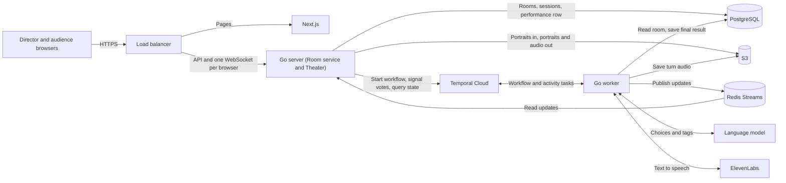
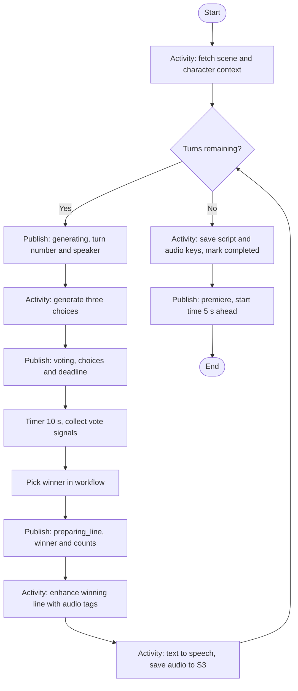
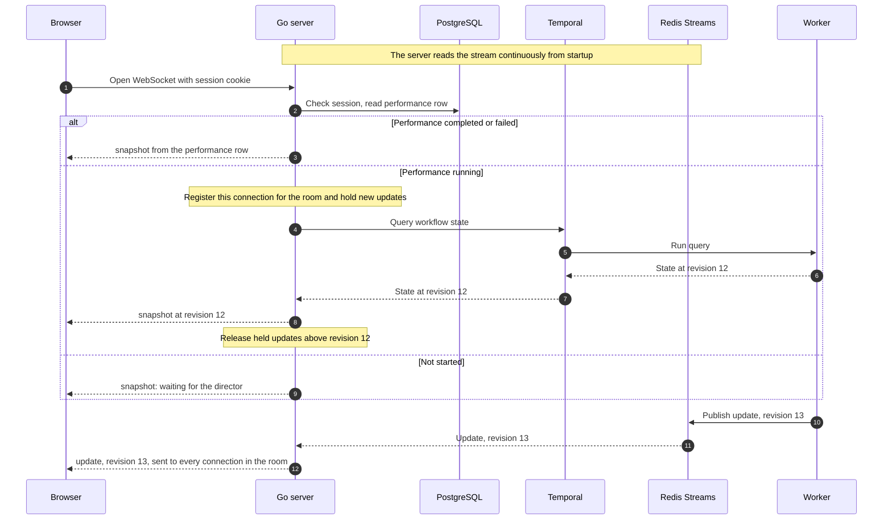

# Monster Theatre — System Design

Status: Simplified design, agreed with the user on 2026-10-07 (D022–D027). It replaces the earlier draft built around PostgreSQL milestone snapshots, live audio streaming, and an S3 data lake. Open items are listed in [the review](review.md).

Source of truth: [Product brief](monster-theatre-product-brief.md). Significant choices are recorded in [Decisions](decisions.md).

## 1. What the system does

1. A director creates a room (scene, two characters, two portraits) and gets a share link.
2. Audience members open the link and enter the theatre.
3. The director starts the performance. For each of eight turns the system generates three lines, the audience votes for ten seconds, and the winning line is shown, tagged, turned into speech, and saved.
4. After turn eight, everyone counts down from five and hears the eight recordings played in order.

### Invariants

- One performance per room. A new run needs a new room (D005).
- Room setup is immutable once created (D013).
- After Start everything is automatic; there are no Stop or retry controls (D007).
- Eight alternating turns, A first, B last.
- One vote per voter per turn; the first vote counts. Voters are the audience sessions (up to ten) and the director, who votes through their own connection under their director ID (D028).
- Audience slots are never released; closing a tab does not free one (D028).
- One winner per turn, chosen once and never changed.
- No audio is played before the premiere (D022).
- S3 is private. Browsers get portraits and audio through the server.

## 2. Components

| Component | Role |
| --- | --- |
| Next.js frontend | Director setup form, audience theatre, voting, premiere player |
| Go server | One process with two modules. **Room service:** create rooms, audience sessions, Start. **Theater:** WebSocket connections, vote signalling, forwarding updates, serving portraits and audio |
| Go worker | A separate process from the same codebase. Runs the performance workflow and its activities (D026) |
| Temporal Cloud | Stores and drives the performance workflow |
| Redis Streams | The worker publishes performance updates; the server reads them and forwards to browsers (D024). ElastiCache on AWS, plain Redis locally |
| PostgreSQL | Rooms, audience sessions, and one row per performance |
| S3 | Portraits and the eight turn recordings |
| Language model | Choice generation and audio-tag enhancement, behind a configurable adapter (D017) |
| ElevenLabs | Speech for each winning line: one request per turn to the Text to Dialogue convert endpoint with `eleven_v4_turbo`, the speaker's voice, and the tagged text |
| Director login | Built into the Go server: administrator-created accounts with hashed passwords, a login form, and a session cookie (D029). Handlers receive a verified director ID from one piece of middleware, so the mechanism can be swapped later |

The server and the worker never talk to each other directly. The server reaches the workflow through Temporal (start, signal, query), and the workflow reaches the server through Redis.

For prototyping, everything runs locally: the Temporal dev server, Redis, and PostgreSQL in containers, with a real S3 bucket or a local stand-in. On AWS the three application processes run as containers on ECS Fargate.

## 3. Stored data

### PostgreSQL

| Table | Holds | Written when |
| --- | --- | --- |
| `directors` | Director ID, username, password hash. Rows are added by an administrator; there is no signup | By hand |
| `director_sessions` | Session ID, director, credential hash, expiry. Same pattern as audience sessions | At login |
| `rooms` | Owner (director ID), scene topic/description/genre, character A and B (name, brief, voice, portrait key), hash of the share-link token | Once, at creation |
| `audience_sessions` | Session ID, room, credential hash, timestamps. See [Audience session](audience-session.md) | When someone enters; `last_seen_at` on reconnect |
| `performances` | Performance ID, room (unique, so one per room), status (`running`, `completed`, `failed`), and on completion the final script and the eight audio keys | A row at Start; one update at the end |

The final script is one JSON document: for each turn the speaker, beat, three choices, vote counts, winner, how it was decided (majority, tie, no votes), the tagged text, and the model used.

There are no snapshot, event, or vote tables. While a performance is running, its state exists only in the workflow.

### S3

| Object | Key | Written when |
| --- | --- | --- |
| Portrait A and B | `rooms/{roomId}/portrait-a`, `portrait-b` | Room creation |
| Turn recording | `performances/{performanceId}/turn-{n}.mp3` | After each turn's speech is generated |

A lifecycle rule expires objects after seven days.

### Temporal workflow state

Room context, current turn and phase, the current round's choices and deadline, who has voted for what, the winners so far, the tagged lines and audio keys so far, and a revision number that increases with every published update.

## 4. Performance workflow

One workflow per performance, with ID `performance/{performanceId}`.

Notes on each part:

- **Publishing is an activity.** Workflow code must be deterministic and cannot talk to Redis itself, so every "Publish" box is a small activity that appends one message to the stream. Before each publish the workflow increases its revision number and includes it in the message.
- **Collecting votes.** A vote arrives as a signal carrying session ID, turn number, and choice ID. The workflow records the first vote from each session for the current turn and ignores repeats, unknown choices, wrong turn numbers, and anything after the timer fires.
- **Picking the winner.** Done in workflow code: most votes wins; a tie or an empty round is settled with Temporal's replay-safe random source, so a replay after a crash reaches the same answer.
- **Fallbacks.** Choice generation retries, then falls back to simple valid lines. Tag enhancement retries, then falls back to the untagged line. Text to speech retries; if it still fails the run fails.
- **Failure.** If the workflow cannot continue, it runs one last activity to mark the performance row `failed` and publishes a `failed` update. A workflow run timeout bounds a run that hangs.
- **Query handler.** The workflow answers a `state` query with its current turn, phase, choices, deadline, votes, winners so far, and revision.

### What is published, and when

Every publish moves the performance into a new phase and increases the revision by one. These are the only publish points:

| When | Phase in the update | What the update carries | What the browser shows |
| --- | --- | --- | --- |
| A turn begins | `generating` | Turn number, speaker, story beat | "Writing the next lines…" |
| Three choices are ready | `voting` | The choices and the deadline | The three choices and a countdown |
| The timer has fired and the winner is picked | `preparing_line` | The winner, vote counts, and how it was decided | The winning line while it is tagged and voiced |
| All eight turns are saved | `premiere` | Start time five seconds ahead and the ordered clip list | Countdown, then playback |
| The run cannot continue | `failed` | A short reason | A failure message |

A normal run publishes three updates per turn and one for the premiere: revisions 1 to 25. Tagging, text to speech, and saving to the database publish nothing of their own; the browser stays in `preparing_line` until the next turn's `generating` arrives (or `premiere` after turn eight).

A possible later improvement: since nothing is played until the premiere, tagging and speech for a turn could run in the background while the next turn's voting proceeds, shortening the wait between rounds. Start with the simple sequential loop.

## 5. Interfaces

### HTTP

| Operation | Who | Behaviour |
| --- | --- | --- |
| `POST /api/v1/director/login` | Anyone | Username and password; on success sets the director session cookie. `POST /api/v1/director/logout` clears it |
| `POST /api/v1/rooms` | Director | One multipart request with scene/character JSON and two portraits. Validate, upload portraits to S3 under a new room ID, insert the room row, return the room ID and share link. On failure the director resubmits (D025) |
| `GET /api/v1/rooms/{roomId}` | Director or audience session of that room | Scene, characters, and the room's performance ID and status if started |
| `POST /api/v1/rooms/{roomId}/performance` | Director | Insert the performance row, then start the workflow. A repeated Start returns the existing performance |
| `POST /api/v1/audience-sessions` | Anyone with the share link | Create or restore a session and set its cookie. Up to ten per room |
| `GET /api/v1/rooms/{roomId}/portraits/{slot}` | Director or audience session | Portrait bytes, read from S3 by the server |
| `GET /api/v1/performances/{id}/turns/{n}/audio` | Director or audience session | Turn recording as `audio/mpeg`, read from S3 by the server. Supports range requests. Available once the performance is completed |

Start is safe to retry: the unique room constraint stops a second row, and starting a workflow whose ID already exists is treated as success.

Validation bounds (unchanged): portraits JPEG, PNG, or WebP up to 5 MiB; names up to 80 characters; briefs up to 400; scene topic up to 200; description up to 1000; genre up to 80; generated lines up to 300.

### WebSocket

Each browser opens its own WebSocket to the server, authenticated by its session cookie (audience) or login (director). It carries state down and votes up. No audio travels on it.

Server to browser:

| Message | Contents |
| --- | --- |
| `snapshot` | Full current state and its revision. Always the first message after connecting |
| `update` | One published change with its revision: new phase, choices and deadline, winner, premiere start time and clip list, or failure |
| `vote_received` | Confirms the server passed this browser's vote to the workflow |
| `error` | A vote could not be delivered (for example, the performance has ended) |

Browser to server:

| Message | Contents |
| --- | --- |
| `vote` | Turn number and choice ID. The voter (audience session or director) comes from the connection, never from the message |

## 6. Flows

### Connecting and staying up to date

The browser replaces its state with each `snapshot` and applies an `update` only if its revision is higher than what it already has. That one rule covers first connection, reconnection, and duplicate delivery.

The server keeps an in-memory map of room to open connections. It reads each update from Redis once and writes it to every connection for that room. The server reads the stream from "now" at startup; history is not needed because snapshots come from the workflow.

### Voting

1. The browser sends `vote` on its WebSocket.
2. The server signals the workflow with the session ID, turn, and choice, then replies `vote_received`.
3. The workflow keeps the vote if it is that session's first for the current turn and the timer has not fired.
4. When the timer fires, the workflow picks the winner and publishes it. Every browser receives the winner and the counts.

A browser that reconnects during a round gets its own vote back in the snapshot, because the workflow state includes who voted and the server sends each browser only its own entry.

### Premiere

1. After the eighth recording is saved, the workflow saves the final script and audio keys to the performance row and marks it `completed`.
2. It publishes `premiere` with a start time five seconds ahead and the ordered clip list (turn, speaker).
3. Each browser counts down to the start time, then plays the eight clips in order with a normal audio element, fetching each from the server, and highlights the portrait of the clip's speaker.
4. A browser that connects after the start time gets the completed snapshot and plays from the beginning.

Playback is not synchronised beyond the shared start time, which the brief accepts.

Two delivery rules keep the premiere continuous and working across browsers:

- **Preloading.** On receiving the `premiere` update, the browser starts fetching all eight clips during the five-second countdown, so each clip is ready before the previous one ends. If a clip is still loading when its turn comes, playback waits for it; nothing is skipped.
- **Range requests.** The audio endpoint answers partial-content requests: it honours the `Range` header, replies `206` with `Accept-Ranges: bytes`, and passes the range through to S3. Safari's audio element expects this.

### Worker restart

- The workflow resumes from its history when a worker is back: completed activities are not repeated, and the timer keeps its original deadline.
- Votes signalled while the worker is down are stored by Temporal and counted on return if they arrived before the timer fired.
- Browsers stay connected to the server throughout and see updates pause, then continue.
- A browser that connects while the worker is down cannot get a snapshot, because a query needs a worker. The server tells it the performance is recovering and the browser retries.

## 7. Limits accepted for the prototype

- No state reads for new connections while the worker is down.
- No history of individual votes after a run; only counts are kept in the final script.
- No single assembled recording; the premiere is eight clips.
- No limit on how many performances run at once (D027).
- A room creation that fails halfway can leave orphaned portraits in S3 until the lifecycle rule removes them.
- An activity may publish the same update twice after a retry; the revision rule makes that harmless.

## 8. Next step

Resolve the open items in [the review](review.md), then write the implementation plan.
