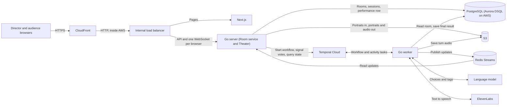
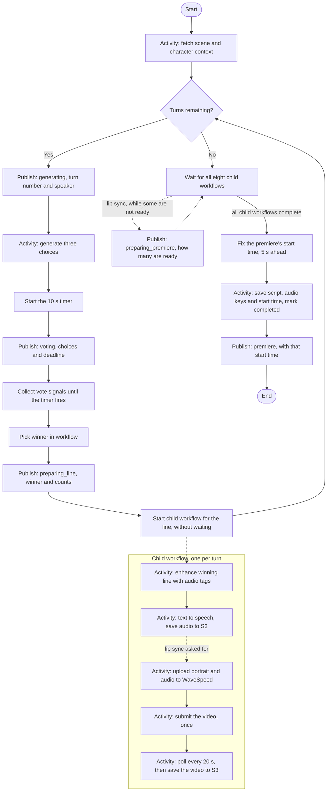
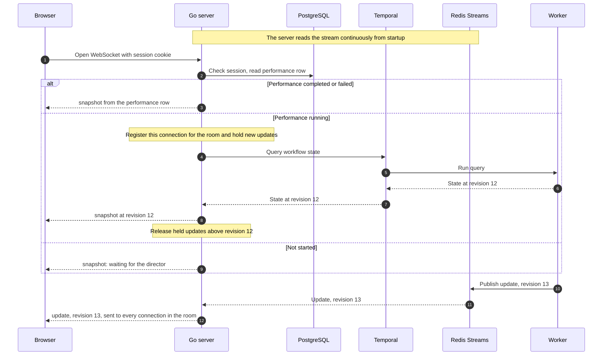

# Monster Theatre — System Design

Status: Simplified design, agreed with the user on 2026-10-07 and 2026-10-08 (D022–D034). It replaces the earlier draft built around PostgreSQL milestone snapshots, live audio streaming, and an S3 data lake. It passed the design-readiness checklist on 2026-10-08; the remaining build-time points are in [the review](review.md).

Source of truth: [Product brief](monster-theatre-product-brief.md). Significant choices are recorded in [Decisions](decisions.md).

## 1. What the system does

1. A director creates a room (scene, two characters, two portraits) and gets a share link.
2. Audience members open the link and enter the theatre.
3. The director starts the performance. For each of eight turns the system generates three lines, the audience votes for ten seconds, and the winning line is shown, tagged, turned into speech, and saved.
4. After turn eight, everyone counts down from five and hears the eight recordings played in order.

### Invariants

- One performance per room. A new run needs a new room (D005).
- Room setup is immutable once created (D013).
- After Start everything is automatic; there are no Stop or retry controls (D007).
- Eight alternating turns, A first, B last.
- One vote per voter per turn; the first vote counts. Voters are the audience sessions (up to ten) and the director, who votes through their own connection under their director ID (D028).
- Audience slots are never released; closing a tab does not free one (D028).
- One winner per turn, chosen once and never changed.
- No audio is played before the premiere (D022).
- S3 is private. Browsers get portraits and audio through the server.

### Requirements and how the design meets them

| Target from the brief | How the design meets it |
| --- | --- |
| Vote acknowledged within 300 ms (p95) | The server replies `vote_received` as soon as Temporal accepts the signal: one network call, no database write |
| Winner shown within one second of the window closing | The workflow already holds the votes when the timer fires; it picks the winner in memory and publishes once |
| One active round, one winner, strict order | A single workflow per performance runs the turns in a loop; nothing else can advance a turn |
| Votes and winners survive a worker restart | Signals and workflow state are stored by Temporal, not by the worker |
| Progression resumes within 60 seconds of a worker restart | Holds when the worker was between activities or waiting on the timer. If it died mid-activity, Temporal waits for that activity's timeout first; see the retry table in section 4 |
| Reconnecting client receives current state | Snapshot from a workflow query, then updates by revision (section 6). Accepted limit: no snapshot while no worker is running |
| Director authentication, link-only audience access, private storage, input limits | Section 7 |
| Media expires after seven days | S3 lifecycle rule. Database rows are not cleaned up in the prototype |
| Failures and retries visible to the operator | Section 8 |
| Desktop browsers, audio unlocked on Enter theatre | The click that joins the room also starts the page's one audio element, which is what lets it play the premiere later (section 6, "The pages"; D044) |

### Capacity

One performance involves at most 11 WebSocket connections, 25 published updates, 88 vote signals, 16 language-model calls, 8 speech calls, and 8 audio files of a few hundred kilobytes each, with only a handful of performances at once. One server instance and one worker instance are enough for that, and one of each is what is deployed. The live path does not depend on there being one server, though: everything a browser is sent reaches the servers through Redis, so a room's director and audience can be connected to different instances (section 6, "More than one server"; D046). What still assumes a single server is listed in section 9.

## 2. Components

| Component | Role |
| --- | --- |
| Next.js frontend | Director setup form, audience theatre, voting, premiere player |
| Go server | One process, of which one instance is deployed, with two modules. **Room service:** create rooms, audience sessions, Start. **Theater:** WebSocket connections, vote signalling, forwarding updates, serving portraits and audio |
| Go worker | A separate process from the same codebase. Runs the performance workflow and its activities (D026) |
| Temporal Cloud | Stores and drives the performance workflow |
| Redis Streams | Two streams, each read whole by every server and forwarded to that server's browsers. `performance-updates`: the worker publishes performance updates (D024). `room-notices`: a server publishes news of its own for the others (D046). Held by Valkey 8.1, which speaks the Redis protocol: one ElastiCache node on AWS, a container locally (D051) |
| PostgreSQL | Rooms, audience sessions, and one row per performance. Aurora DSQL on AWS, a plain PostgreSQL container locally (D032) |
| S3 | Portraits and the eight turn recordings |
| Language model | Choice generation and audio-tag enhancement, behind a configurable adapter (D017) |
| ElevenLabs | Speech for each winning line: one request per turn to the Text to Dialogue convert endpoint with `eleven_v4_turbo`, the speaker's voice, and the tagged text |
| Director login | Built into the Go server: administrator-created accounts with hashed passwords, a login form, and a session cookie (D029). Handlers receive a verified director ID from one piece of middleware, so the mechanism can be swapped later |



The server and the worker never talk to each other directly. The server reaches the workflow through Temporal (start, signal, query), and the workflow reaches the server through Redis.

The browser sees one origin. On AWS that origin is a CloudFront distribution, at its own `cloudfront.net` address since there is no domain name (D049); behind it an internal load balancer routes `/api/*` and the WebSocket to the Go server and everything else to Next.js. Locally the Next.js app does that routing itself, proxying `/api/*` to the Go server, so cookies need no cross-origin handling in either place. Pages fetch from the API in the browser; Next.js does no data fetching of its own.

For prototyping, everything runs locally: the Temporal dev server, Redis, and PostgreSQL in containers, with a real S3 bucket or a local stand-in. On AWS the three application processes run as containers on ECS Fargate, one task each, in public subnets with no NAT gateway (D050), and the database is Aurora DSQL. The deployment is two CDK stacks, one kept and one destroyed between demos (D052); the README has the commands and the cost.

## 3. Stored data

### PostgreSQL

| Table | Holds | Written when |
| --- | --- | --- |
| `directors` | Director ID, username, password hash. Rows are added by an administrator; there is no signup | By hand |
| `director_sessions` | Session ID, director, credential hash, expiry. Same pattern as audience sessions | At login |
| `rooms` | Owner (director ID), scene topic/description/genre, character A and B (name, brief, voice ID, portrait key), and `audience_count`. Nothing about the share link is stored (D034) | Once, at creation; `audience_count` goes up by one per new audience session |
| `audience_sessions` | Session ID, room, credential hash, nickname, timestamps. See [Audience session](audience-session.md) | When someone enters; `last_seen_at` on reconnect; the nickname again each time the same browser re-enters |
| `performances` | Performance ID, room (unique, so one per room), status (`running`, `completed`, `failed`), the failure reason on a failed run, and on completion the final script and the eight audio keys, each a `jsonb` column (Aurora DSQL has no stored array type), and the time the premiere starts | A row at Start; one update at the end |

The final script is one JSON document: for each turn the speaker, beat, three choices, vote counts, winner, how it was decided (majority, tie, no votes), the tagged text, whether tags were applied (false when tagging failed and the plain line was spoken), and the model that wrote the choices.

There are no snapshot, event, or vote tables. While a performance is running, its state exists only in the workflow.

### Working on both databases

The same code runs against local PostgreSQL and Aurora DSQL (D032). Four rules make that possible:

- **Retry on conflict.** Aurora DSQL has no row locks; a transaction that conflicts with another fails at commit with SQLSTATE `40001`. Every write transaction runs through one helper that retries on that error with backoff. On local PostgreSQL the helper never has anything to retry.
- **Session cap by counter.** Admitting an audience member is one transaction: `UPDATE rooms SET audience_count = audience_count + 1 WHERE id = $1 AND audience_count < 10`, then the session insert. If the update changes no row, the room is full. Locally the row lock makes simultaneous joins queue; on DSQL they conflict and one retries.
- **Application-generated UUID keys.** No sequences are used.
- **Plain migrations.** One schema statement per migration, never mixed with data changes, and no column drops or type changes without recreating the table. On DSQL, indexes are created with `CREATE INDEX ASYNC`, which PostgreSQL does not accept. The files say `CREATE INDEX`; the migrate command, when pointed at DSQL, reads them with `ASYNC` inserted, runs each statement apart from goose's own bookkeeping, and waits for the index builds (D048).
- **Indexable types only where an index is needed.** DSQL cannot index `bytea` or `jsonb`. The session hash, which is unique and so indexed, is stored as hex in a `text` column (D047); the two `jsonb` columns are never filtered on.
- **An index for every filter.** Each query filters by a primary key, a unique column, or an indexed one. Two needed an index of their own, on the column filtered by and the one ordered by: `audience_sessions (room_id, created_at)`, for a room's audience in joining order, read on every join; and `rooms (director_id, created_at)`, for a director's room list. A test checks that both exist and that the planner can use them for the real statements.

Nothing in the schema needs triggers, extensions, or LISTEN/NOTIFY, which DSQL does not support. The final script is a `jsonb` column well under DSQL's 1 MiB limit.

### S3

| Object | Key | Written when |
| --- | --- | --- |
| Portrait A and B | `rooms/{roomId}/portrait-a`, `portrait-b` | Room creation |
| Turn recording | `performances/{performanceId}/turn-{n}.mp3` | After each turn's speech is generated |

A lifecycle rule expires objects after seven days.

### Temporal workflow state

Room context, current turn and phase, the current round's choices and deadline, who has voted for what, the winners so far, the tagged lines and audio keys of the turns whose child workflows have finished, and a revision number that increases with every published update. Each turn's child workflow has its own history: the tagging and speech activities and their result.

## 4. Performance workflow

One workflow per performance, with ID `performance/{performanceId}`, and one child workflow per turn, `performance/{performanceId}/line-{turn}`, which tags and voices that turn's winning line in the background (D053).



Notes on each part:

- **Publishing is an activity.** Workflow code must be deterministic and cannot talk to Redis itself, so every "Publish" box is a small activity that appends one message to the stream. Before each publish the workflow increases its revision number and includes it in the message.
- **Timer before publish.** The workflow computes the deadline (its current time plus the window), starts the 10-second timer, and then publishes that deadline, so browsers show the same deadline the workflow enforces.
- **Collecting votes.** A vote arrives as a signal carrying a voter ID (an audience session ID or the director's ID), turn number, and choice ID. The signal also carries the time the server received the vote. The workflow records the first vote from each voter for the current turn and ignores repeats, unknown choices, wrong turn numbers, and late votes.
- **Deciding lateness.** A vote is in time if the server's receipt time is at or before the deadline, and not before the round opened. (Choice IDs are the same every turn, so without the second half a vote sent before the choices were shown would count.) The workflow does not rely on whether it saw the vote before or after the timer: the step 2 spike showed that after a worker outage those arrive together and their order is lost (D033). When the timer is delivered, the workflow first handles every vote still buffered, then closes the round. A vote that reaches the workflow after the round has closed is ignored whatever its stamp says.
- **Tagging and speech run in the background.** Once the winner is published, the workflow starts the turn's child workflow and goes straight on to the next turn: nothing needs the recording before the premiere, and the next lines are written from the untagged text. After turn 8 it waits for all eight children, then saves and publishes the premiere. The script and the audio keys are put together in turn order, whatever order the children finished in. If a child fails, the workflow cancels whatever it is doing at that moment (writing lines or holding a round open) and fails the run with `speech_failed`. A child still running when the workflow ends is terminated with it.
- **Picking the winner.** Done in workflow code: most votes wins; a tie or an empty round is settled with Temporal's replay-safe random source, so a replay after a crash reaches the same answer.
- **When a provider fails.** Choice generation is retried with growing pauses for a whole retry window (two minutes by default), which rides out a brief outage; if the window runs out, the run fails. There is no stand-in for lines the model did not write (D038). Tag enhancement retries, then falls back to the untagged line, which is still the real line. Text to speech retries; if it still fails, the turn's child workflow fails and the run stops at once, in whatever turn it has reached. An error that retrying cannot fix, such as a rejected API key, stops at once.
- **Checking what the model returns.** Whichever model is configured, its answers are checked before they are used. Choices must be exactly three, each non-empty, at most `MAX_LINE_LENGTH` characters (160 by default), on one line, without square brackets, and all different. A tagged line, with its square-bracket tags removed, must be the original line word for word. An answer that fails its check is a failed attempt, retried like any other.
- **The premiere's start time.** The workflow fixes it (its current time plus the countdown) before the save, and the one write that marks the row `completed` stores it with the script. The premiere update then carries the same value, so a browser that connects later is told the same time as those who were watching (D039). The save therefore comes out of the countdown: milliseconds normally, more if the database is being retried.
- **Failure.** If the workflow cannot continue, it runs one last activity to mark the performance row `failed` with the reason, then publishes a `failed` update carrying that reason, and ends as a failed workflow so the operator sees it in Temporal. The row is marked first, so a browser told of the failure finds the row agreeing. Reasons: `choices_failed`, `speech_failed`, and `internal_error` for anything else. A workflow run timeout bounds a run that hangs; a run ended that way cannot mark its own row, which the connect-time rule in section 6 handles.
- **A failed publish does not stop the run.** Publishing retries briefly and then the workflow carries on. A browser that receives an update whose revision skips a number knows it missed one and asks for a fresh snapshot.
- **Query handler.** The workflow answers a `state` query with its current turn, phase, choices, deadline, votes, winners so far, and revision. The answer has the same shape as a published update's state, so the server passes it on as the snapshot unchanged.
- **Settings.** The vote window and the premiere countdown are the worker's settings (`VOTE_WINDOW`, `PREMIERE_COUNTDOWN`). The first activity returns them with the room context, so the values a run used are recorded in its history and a replay sees the same ones.

### What is published, and when

Every publish moves the performance into a new phase and increases the revision by one. These are the only publish points:

| When | Phase in the update | What the update carries | What the browser shows |
| --- | --- | --- | --- |
| A turn begins | `generating` | Turn number, speaker, story beat | The previous round's result, if the page was told it, and "Writing the next lines…" |
| Three choices are ready | `voting` | The choices and the deadline | The three choices and a countdown |
| The timer has fired and the winner is picked | `preparing_line` | The winner, vote counts, and how it was decided | The winning line, its counts, and how it was decided; the page keeps these on screen through the next turn's `generating` (D053) |
| Lip sync only: the turns are over and some videos are not ready; then again each time the count changes | `preparing_premiere` | `progress: {ready, total}` | Turn 8's result and "5 of 8 clips have been generated…" (D055) |
| All eight turns are saved | `premiere` | The start time, fixed five seconds ahead just before the save, and the ordered clip list, each clip with its URL, and its `videoUrl` where it has a lip-sync video | Countdown, then playback; or, once the start time has passed, the recording ready to play from the beginning |
| The run cannot continue | `failed` | `failure`: a reason code and a sentence for the audience | A failure message |

Before Start there is one more phase, `waiting`, which is never published: with no performance there is no workflow to publish it. It appears only in the snapshot the server builds for a room that has not started, at revision 0, so the first published update is always newer.

One more phase is never published: `recovering`, which the server sends in a snapshot, at revision 0, when a performance is running but its workflow cannot be asked for its state (section 6).

There is no phase for "finished". A performance stays in its last phase, `premiere` or `failed`, for good, and the row's status (`completed` or `failed`) is what tells the server to answer from the row instead of the workflow (section 6).

A normal run publishes three updates per turn and one for the premiere: revisions 1 to 25. A run with lip sync may publish `preparing_premiere` updates between turn 8 and the premiere, so its premiere's revision is higher; that revision is saved with the script and is the one a finished room's snapshot carries (D055). Tagging, text to speech, and saving to the database publish nothing of their own. Tagging and speech run in the background, so `preparing_line` is followed within milliseconds by the next turn's `generating`; after turn eight it stays until `premiere`, while the last line is voiced.

### Retries and timeouts

Proposed starting values, to tune while building:

| Activity | Timeout per attempt | Attempts | Then |
| --- | --- | --- | --- |
| Generate choices | 30 s | As many as fit in the retry window (`CHOICES_RETRY_WINDOW`, default 2 min), pausing 1 s, 2 s, 4 s, 8 s, then 15 s between them | Run fails |
| Enhance tags | 20 s | 2 | Untagged line |
| Text to speech | 60 s | 3 | Run fails |
| A turn's child workflow (tags, then speech) | 5 min in all, 25 with lip sync | 1 | Run fails |
| Lip sync: upload the portrait and recording | 1 min | 3 | The line has no video |
| Lip sync: submit the video | 1 min | 1, never repeated: a lost answer may still have started a paid video | The line has no video |
| Lip sync: wait for the video, poll every 20 s | 15 min in all, heartbeat every poll, 1 min heartbeat timeout | Retried until the 15 minutes are up; a failed video or a 4xx ends it | The line has no video |
| Publish update | 5 s | 3 | Continue without it |
| Database read or write | 10 s | Until the run timeout | — |
| Whole workflow run | 30 min; 45 with lip sync | — | Run ends |

If a worker dies in the middle of an activity, Temporal waits for that activity's timeout before trying it again on another worker. Worst-case resumption is therefore the longest timeout above, not the worker's restart time.


## 5. Interfaces

### HTTP

| Operation | Who | Behaviour |
| --- | --- | --- |
| `POST /api/v1/director/login` | Anyone | Username and password as JSON; on success sets the director session cookie. Wrong password and unknown username get the same `401`. `POST /api/v1/director/logout` deletes the session and clears the cookie |
| `GET /api/v1/director/me` | Director | The logged-in director's ID and username; `401` without a live session. The web pages use it to know whether someone is logged in |
| `POST /api/v1/rooms` | Director | One multipart request with scene/character JSON and two portraits. Validate, upload portraits to S3 under a new room ID, insert the room row, return the room ID and share link. Invalid input gets `422` naming each field; an oversize portrait gets `413`. On failure the director resubmits (D025) |
| `GET /api/v1/rooms` | Director | The director's own rooms, newest first, so a director who closed the tab can find a room again |
| `GET /api/v1/rooms/{roomId}` | Director or audience session of that room | Scene and characters. The director's view adds the share link and `audienceCount`; the audience's view has neither. `401` with no credentials, `403` for a director who does not own the room |
| `POST /api/v1/rooms/{roomId}/performance` | Director | The body is an empty JSON object. Insert the performance row, then start the workflow. Returns `{performanceId, roomId, status}`: `201` the first time, `200` for a repeated Start, which returns the existing performance. `503` if the workflow could not be started; pressing again repairs it, and nothing else does: until then the row says `running` with nothing running it, and browsers in the room are told it is recovering (D043) |
| `POST /api/v1/audience-sessions` | Anyone with the share link | Takes the link's room ID and token, and a `nickname`: required, trimmed, 1 to 30 characters, not necessarily unique. `201` and a cookie for a new session; `200` with `restored: true` for a browser that already has one, whose nickname is replaced by the one given; `403` for any invalid link; `409` when the room has ten; `422` `invalid_nickname`, naming the field, for a missing or over-long nickname. A link is checked before a nickname. See [Audience session](audience-session.md) |
| `GET /api/v1/rooms/{roomId}/portraits/{slot}` | Director or audience session | Portrait bytes, read from S3 by the server |
| `GET /api/v1/performances/{id}/turns/{n}/audio` | Director or audience session of the performance's room | Turn recording as `audio/mpeg`, piped from S3 by the server, never buffered. Supports range requests (section 6). The caller is checked first, with the same `401` and `403` as reading the room. Then `404` for a turn outside 1 to 8, and `409` `performance_not_completed` while the performance is running or if it failed: no recording is served before the premiere, and a failed run's are never served. An unknown performance gets `401` without a director login and `404` with one, as an unknown room does. Responses carry `Cache-Control: private, max-age=604800, immutable`, as portraits do: a recording never changes, and only the room's people may keep one |
| `GET /api/v1/performances/{id}/turns/{n}/video` | Director or audience session of the performance's room | The turn's lip-sync video as `video/mp4`, on the same terms as its recording, range requests included. `404` for a turn without a video: a run without lip sync, or a line whose video could not be made (D055) |
| `GET /api/v1/rooms/{roomId}/ws` | Director or audience session of that room | Upgrades to the WebSocket described below. Refusals are ordinary JSON errors sent before the upgrade: `403` `origin_not_allowed` for a page on another origin, then the same `401`, `403`, and `404` as reading the room |

Start is safe to retry: the unique room constraint stops a second row, and starting a workflow whose ID already exists is treated as success. While the row says `running`, every Start asks Temporal to start the workflow; a running one is left alone and a finished one is never run again. A row that is `completed` or `failed` is returned as it is.

Every error response has the same shape, `{"error": {"code": "...", "message": "..."}}`, where the code is stable and the message is for people.

Error outcomes: `401` not logged in or no session; `403` not your room; `404` unknown room, performance, or turn; `409` room already has ten sessions, a conflicting Start, or audio asked for from a performance that has not completed; `413` upload too large; `422` invalid fields or image; `429` too many login attempts.

Validation bounds (unchanged): portraits JPEG, PNG, or WebP up to 5 MiB; names up to 80 characters; briefs up to 400; scene topic up to 200; description up to 1000; genre up to 80; generated lines up to `MAX_LINE_LENGTH`, a worker setting: 160 by default, and settable from 60 to 300. The model is asked for five sixths of that (130 by default), so an answer that runs a little long still passes.

### WebSocket

Each browser opens its own WebSocket to the server, authenticated by its session cookie (audience) or login (director). It carries state down and votes up. No audio travels on it.

Server to browser:

| Message | Contents |
| --- | --- |
| `snapshot` | Full current state and its revision. Always the first message after connecting. Also the reply to `resync`, and sent unasked to a whole room in one case: when a run is found dead (section 6) |
| `update` | One published change with its revision. It carries the whole state as it now stands, in the same shape as a snapshot, not only what changed (D036) |
| `vote_received` | Confirms the server passed this browser's vote to the workflow, and names it: `{"type": "vote_received", "turn": 1, "choiceId": "c2"}`. It does not say the vote counted; only the workflow knows that, and a browser sees what counted as `yourVote` in its next snapshot |
| `audience` | Who is in the room's audience: `{"type": "audience", "count": 2, "nicknames": ["Ana", "Ben"]}`, in the order they joined. Sent **only to connections opened by the room's director**: straight after the snapshot, and again whenever someone is admitted or changes their name. It is no part of the performance's state and has no revision; each one replaces the last (D045) |
| `error` | Something this browser sent could not be acted on: `{"type": "error", "code": "…", "message": "…"}`. Codes: `vote_not_delivered` (the performance has not started, has ended, or the workflow could not be reached) and `invalid_message` (not a readable message, or a vote without a turn from 1 to 8 and a choice) |

Every server message has the same envelope. A snapshot for a room that has not started:

```json
{"type": "snapshot", "revision": 0, "state": {"phase": "waiting", "turn": 0}}
```

Browser to server:

| Message | Contents |
| --- | --- |
| `vote` | Turn number and choice ID: `{"type": "vote", "turn": 1, "choiceId": "c2"}`. The voter (audience session or director) comes from the connection, never from the message |
| `resync` | `{"type": "resync"}`. Asks for a fresh `snapshot`, which is the reply: taken exactly as the first one was, with the browser's own `yourVote`. Sent when the browser sees a gap in revision numbers, and every few seconds while the phase is `recovering`. One a second is answered per connection; another inside that second is ignored, which loses nothing, since the browser has just had a snapshot and every update carries the whole state |

The state of a running performance. A field is absent in the phases that do not have it:

```json
{"type": "update", "revision": 6, "state": {
  "phase": "preparing_line", "turn": 2, "performanceId": "…", "speaker": "B", "beat": "QUESTION",
  "choices": [{"id": "c1", "text": "…"}, {"id": "c2", "text": "…"}, {"id": "c3", "text": "…"}],
  "winner": {"choiceId": "c2", "text": "…", "counts": {"c1": 0, "c2": 0, "c3": 0}, "decidedBy": "no_votes"},
  "lines": [{"turn": 1, "speaker": "A", "text": "…"}, {"turn": 2, "speaker": "B", "text": "…"}]}}
```

| Field | Present in | Meaning |
| --- | --- | --- |
| `phase`, `turn` | Always | `turn` is 0 before the first turn, and in a `recovering` snapshot, which carries only the `performanceId` besides |
| `performanceId` | Once started | Needed to fetch the recordings |
| `speaker`, `beat` | `generating`, `voting`, `preparing_line` | `A` or `B`, and the turn's story beat |
| `choices` | `voting`, `preparing_line` | The three lines, with IDs `c1` to `c3` |
| `deadline` | `voting` | When the round closes |
| `winner` | `preparing_line` | The chosen line, each choice's count, and `decidedBy`: `majority` (the most votes, not necessarily more than half), `tie`, or `no_votes` |
| `yourVote` | Snapshots only, in `voting` and `preparing_line` | The choice ID this browser's voter has made in the current turn. Absent if they have not voted. Never in an update, which every browser in the room receives alike |
| `lines` | From the first winner on | The winning lines so far, in order |
| `progress` | `preparing_premiere` | `{ready, total}`: how many of a lip-sync run's videos are ready. A line whose video failed counts as ready |
| `premiere` | `premiere` | `startsAt` and the ordered `clips`. Each clip is `{turn, speaker, url, videoUrl?}`, where `url` is a path on the server such as `/api/v1/performances/{id}/turns/1/audio` (D037), and `videoUrl`, present only for a turn with a lip-sync video, is `/api/v1/performances/{id}/turns/1/video` (D056). `startsAt` is in the future for a browser there at the time and in the past for one that connects afterwards; the browser counts down or offers the recording accordingly |
| `failure` | `failed` | `{code, message}`. `code` is `choices_failed`, `speech_failed`, or `internal_error`; `message` is a sentence for the audience |

The winning line with its audio tags is not sent to browsers. It goes to the speech service and into the final script.

**Heartbeat.** The server pings each connection every 25 seconds and drops one that has not answered within 10. Browsers answer pings by themselves. This keeps a quiet connection alive through the load balancer's idle timeout and clears dead ones from the server's map.

**Closing.** The server closes a connection with code `1001` when it shuts down, with `1008` when a browser has fallen so far behind that its queue of unsent messages is full, and with `1013` when it could not read the performance from the database, so has no snapshot to send. In each case the browser reconnects and gets a fresh snapshot. A workflow that cannot be asked is not a reason to close: the browser is sent `recovering` and kept.

## 6. Flows

### Connecting and staying up to date



The browser replaces its state with each `snapshot` and applies an `update` only if its revision is higher than what it already has. That one rule covers first connection, reconnection, and duplicate delivery.

A finished performance's snapshot is built from its row, with no worker needed (D039):

| Row | Snapshot | Revision |
| --- | --- | --- |
| `completed` | The `premiere` state exactly as it was published: `turn` 8, the eight `lines`, and `premiere` with the stored `startsAt` and the clips. Lines and clips are rebuilt from the saved script | 25, the last revision of every completed run (three updates a turn, then the premiere), so nothing needs storing |
| `failed` | `phase: failed` with `failure` built from the stored reason. No `turn` or `lines`: a failed run saves no script | 0, because the row does not record how far the run got. A `failed` update still on its way is therefore let through; it says the same, with the turn and lines added |

The row is marked `completed` a moment before the premiere update is published. A browser that connects in between gets the premiere from the row at revision 25, and the update is then dropped for it as nothing new.

If the performance row says `running`, the workflow is asked for its state, on one condition: that it is still open. Temporal refuses the query otherwise. That gives three outcomes from one call:

| Outcome | Meaning | Server does |
| --- | --- | --- |
| Answered | The run is alive and a worker is up | Sends the answer as the snapshot |
| Refused: the workflow has closed | The run ended without updating its row: stopped by its timeout, or from outside | Marks the row `failed` with `internal_error`, reads the row again, and sends that snapshot, to this browser and to every other connection in the room (D042) |
| Anything else: no answer in five seconds, no such workflow, Temporal unreachable | Usually no worker is up. Or Start wrote the row and never started the workflow | Sends a snapshot with phase `recovering` at revision 0, and keeps the connection (D041) |

The condition matters. Without it Temporal has a worker rebuild a closed run and answer with the state it stopped in, so a run that died mid-round would be shown as a round still open, for ever.

Marking changes only a row that is still `running`, and the room is told only when this was the call that marked it. A run that ended properly in the moment between the row being read and the workflow being asked, by completing or by failing and marking its own row, is therefore answered as it ended, and nothing is announced: the room gets the workflow's own update.

A browser sent `recovering` stays in the room. It asks again with `resync` every few seconds, and it is sent the next update like everyone else as soon as the worker is back; either one puts it right.

A missing workflow is not started by a connecting browser (D043). The server cannot tell a Start that has not finished from a workflow Temporal has forgotten, and starting the second kind would bring an old room to life when someone opened it. The director pressing Start again starts it; until then the room says `recovering`.

Each server keeps an in-memory map of room to the connections it holds. It reads each update from Redis once and writes it to every one of its connections for that room. The map is only the last hop, from a server to its own browsers; nothing is ever delivered by writing to it alone. A server reads the streams from "now" at startup; history is not needed because snapshots come from the workflow.

All performances share one stream, `performance-updates`. Each entry holds the room ID, the revision, and the message exactly as browsers receive it. The stream is trimmed to about a thousand entries. The reader notes the stream's last entry at startup and from then on always reads on from the last entry it has seen, including after a Redis outage; asking only for "what is new" on each read would lose an update that arrived between two reads.

#### More than one server

One server is deployed, but a room's people need not be on the same one (D046). What makes that so:

| What a browser is sent, or sends | How it crosses servers |
| --- | --- |
| Performance updates | The worker appends them to `performance-updates`; every server reads the whole stream, with no consumer group, so each gets every entry |
| The `audience` message (D045) | The server that handled the join or rename appends a notice to `room-notices`: the room ID and `audience_changed`, and nothing else. Every server reads it; one that holds that room's director's connection then reads the names from the database and sends them. Reading on receipt, and not carrying the names in the notice, is what keeps two joins handled by two servers from leaving the director with the older list |
| The failed snapshot for a run found dead (D042) | The server that found it appends a notice carrying the snapshot and the ID of the connection it has already answered; every server sends it to the room's other connections |
| Votes | A signal to Temporal, from whichever server holds the connection |
| Snapshots | A Temporal query, or the performance row; any server can ask |
| Sessions and logins | PostgreSQL, so any server recognises any cookie, and no sticky routing is needed |

A server that publishes a notice does nothing else with it: it hears its own notice from the stream and acts then, exactly as the others do, so one server and several run the same code. If the notice cannot be written, the server acts on it for its own connections directly, which with one server is everyone. Both streams are read in one blocking call, each resumed from its own last entry.

`room-notices` is one stream for all rooms, trimmed to about a thousand entries. A stream per room was considered and set aside: each server would have to follow a changing set of streams, and the gain is small unless updates move to per-room streams as well. The split can be made later without changing any page or message.

### Voting

1. The browser sends `vote` on its WebSocket.
2. The server notes the time, signals the workflow with the voter ID, turn, choice, and that receipt time, then replies `vote_received`. The room's performance is looked up in the database once per connection, when a vote first needs it; after that a vote is one call to Temporal. A room with no performance yet, or a signal Temporal refuses because the workflow has finished, gets `error`. A vote sent between rounds, or in the moment after the last update while the workflow is still closing, is acknowledged and then ignored by the workflow. A connection passes on one vote per turn: a repeat on the same connection is answered with the vote already passed on and is not signalled again, so a stuck or hostile browser cannot fill the workflow's history.
3. The workflow keeps the vote if it is for the current turn and one of its three choices, is that voter's first for the turn, was received between the round's opening and its deadline, and the round has not yet closed. Anything else is dropped silently.
4. When the timer fires, the workflow picks the winner and publishes it. Every browser receives the winner and the counts.

A browser that reconnects during a round gets its own vote back in the snapshot, as `yourVote`. The server passes the connection's voter ID with the `state` query, and the workflow, which holds who voted for what, answers with that voter's entry only. Nobody is shown another voter's choice, and no counts are shown until the round closes.

### Premiere

1. After the eighth recording is saved, the workflow fixes the start time five seconds ahead, saves it with the final script and audio keys to the performance row, and marks the row `completed`.
2. It publishes `premiere` with that start time and the ordered clip list (turn, speaker, URL).
3. Each browser counts down to the start time, then plays the eight clips in order through one audio element, each fetched from the URL the clip carries, and highlights the portrait of the clip's speaker and its line in the script. The browser never builds an audio address itself.
4. A browser that connects later gets the same `premiere` state as its snapshot, from the row. If the start time is still ahead it joins the countdown; if it has passed, the browser offers the recording from the beginning. This is also how a finished room is replayed, by anyone who can still enter it.

Playback is not synchronised beyond the shared start time, which the brief accepts.

Two delivery rules keep the premiere continuous and working across browsers:

- **Preloading.** On receiving the `premiere` state, the browser fetches all eight clips whole, during the five-second countdown, and plays from those copies, so each clip is ready before the previous one ends. If a clip is still loading when its turn comes, playback waits for it; nothing is skipped. With real recordings a clip is about 150 KB.
- **Range requests.** The audio endpoint answers partial-content requests: it honours the `Range` header, replies `206` with `Accept-Ranges: bytes` (and `416` for a range past the end), and reads only the bytes asked for from S3. Safari's audio element expects this. The parsing and the replies are Go's `http.ServeContent`; the object store hands it a body that can seek, which over S3 means a ranged read from the offset sought (D040).

### Worker restart

- The workflow resumes from its history when a worker is back: completed activities are not repeated, and the timer keeps its original deadline.
- Votes signalled while the worker is down are stored by Temporal. On return the workflow counts those whose receipt time is not after the deadline, and rejects the rest (D033).
- Browsers stay connected to the server throughout and see updates pause, then continue.
- A browser that connects while the worker is down cannot get the performance's state, because a query needs a worker. Its snapshot says `recovering`; it stays connected, asks again with `resync`, and is sent the next update with everyone else once the worker is back.

### The pages

Two pages show a room live, and both use one component for it (`web/src/components/Theatre.tsx`): the audience page at the share link, `/join/{roomId}/{token}`, and the director's room page.

- **Entering.** The audience page always opens on an **Enter theatre** button, after a reload too. A browser lets a page make sound only once the person has clicked on it, so every page load needs a click; that click also posts to the join endpoint, which gives a returning browser its session back and uses no seat. The director's page connects without a click, and its click is **Start**.
- **Sound.** The page has one audio element. It is started, on a moment of silence, inside the click, and every clip is then played through it: Chrome allows later playback on a page that has been clicked, and Safari allows it for the element that was played during the click. If the browser still refuses at the premiere (a director who reloaded mid-run has not clicked), the page shows **Tap to hear audio**, and the tap starts the performance from its first clip.
- **What each phase shows.** `waiting`: Start for the director, with an **Include lip-sync video** checkbox, unticked, and "Waiting for the director" for the audience. `generating`: the previous round's result, if this page was told it (D053), then whose turn it is and "Writing the next lines…". `voting`: the three lines as buttons and the seconds left; the first click is the vote and the buttons then stop taking clicks. `preparing_line`: the winning line, how it was decided, each line's count, and "Preparing the next line…" (after turn 8 only, in practice: earlier, the next turn's `generating` follows within milliseconds). `preparing_premiere` (lip sync only): turn 8's result, and "5 of 8 clips have been generated…". `premiere`: a countdown if its start time is ahead, otherwise **Play performance**; **Play again** once it has played. While a recording plays, its speaker takes the stage: the portrait over the whole window, as large as it fits at its own shape, with the line beneath it and the page dark and blurred behind (D054). A line with a lip-sync video shows the video there instead, muted, while its recording plays as before (D056). `failed`: the reason. `recovering`: a line saying so. The script so far is listed under all of them.
- **The script.** While the turns run, the winning lines so far are listed newest first. At the premiere, while a recording plays, only the line being spoken is shown, replaced by the next when it starts; with nothing playing (the countdown, a finished room before it is played, and after the last line) the whole script is listed in the order it is spoken. The rule is one function, `web/src/lib/script.ts`.
- **Nicknames and the audience list.** The audience page asks for a nickname with the Enter theatre click, on every load, filled in from what that browser last typed for the room (kept in the browser's own storage, since the page cannot read the session cookie). What is in the field when Enter is pressed becomes the session's name. The director's room page shows the count and the names from the `audience` message, so they change as people join, without a reload. The audience is shown neither.
- **Limits on the forms.** Each text field with a limit shows how much of it is used, as `12 / 200`, counted by character as the server counts.
- **Staying connected.** A dropped WebSocket is reopened after 1, 2, 4, 8, then every 10 seconds, with "Reconnecting…" shown meanwhile. An update that skips a revision is applied, since it carries the whole state, and a `resync` is sent for the browser's own vote. While the phase is `recovering` a `resync` is sent every three seconds.

## 7. Security

- **Sessions.** Audience and director sessions use the same scheme (D030): a random secret in an `HttpOnly`, `Secure`, `SameSite=Lax` cookie, with only its hash stored. Sessions expire after seven days.
- **Share link.** `{PUBLIC_BASE_URL}/join/{roomId}/{token}`, where the token is an HMAC-SHA256 of the room ID under `SHARE_LINK_SECRET` (D034). Nothing is stored: the link is rebuilt whenever the director's page needs it and checked by recomputing. It is valid for the life of the room and grants an audience session for that room and nothing else. The server refuses to start without the secret, and changing the secret invalidates every existing link.
- **Portraits.** The type is detected from the file's own bytes, not from what the uploader claims; animated images and anything over 4096 by 4096 pixels are refused. Portraits are served with `nosniff`.
- **Ownership.** Every director operation checks that the room belongs to the logged-in director.
- **WebSocket.** The handshake is authenticated by cookie, so the server also checks the `Origin` header and refuses connections from other sites (D035). The header must be present and name either the web app's origin (`PUBLIC_BASE_URL`: scheme, host, and port) or the host and port the request itself was addressed to. The check runs before any session lookup.
- **Login.** Passwords are stored with argon2id. Five failed attempts for a username within 15 minutes lock that username until the 15 minutes have passed, and the lock applies even to the correct password. The count is held in server memory. Accepted cost: someone who knows a director's username can lock that director out for 15 minutes.
- **Cookie `Secure` flag.** On by default and controlled by `COOKIE_SECURE`. Local development and the test stack turn it off because they serve plain HTTP.
- **Secrets.** Language-model, ElevenLabs, and WaveSpeed keys are held only by the worker; the Temporal Cloud API key by server and worker; the share-link secret by the server. On AWS all five are in Secrets Manager and reach a task as it starts; none is in a template, a task definition, or the repository, and a deployment in test mode is not given the provider keys at all (D052). Nothing is sent to browsers.
- **Database.** On AWS the server and worker connect to Aurora DSQL with short-lived IAM tokens issued to their task roles, through a scoped database role, `monster_app`, which can read and write the five tables and cannot change the schema (D048). There is no database password to store. Migrations run as `admin`, from an administrator's machine.
- **Storage.** The S3 bucket is private, encrypted, and refuses requests not made over TLS. Browsers reach portraits, audio, and videos only through the server's authorised endpoints.
- **Lip sync (D055).** When a director asks for it, the speaker's portrait and each recording are uploaded to WaveSpeed, which keeps uploads for seven days, and the video it makes is downloaded and kept with the recordings. The WaveSpeed key is sent only to WaveSpeed's API, never to the storage hosts it uploads to or downloads from.
- **Network.** Only CloudFront is reachable from the internet. The load balancer and the cache have no public address, and the load balancer admits only CloudFront's origin-facing addresses; the tasks have one each, for outbound calls, and their security groups admit only the load balancer (D050). The hop from CloudFront to the load balancer is plain HTTP inside AWS's network (D049).
- **Input limits.** The validation bounds in section 5 apply to every upload and text field.

## 8. Observability

- Server and worker write structured logs that carry the room ID and performance ID on every line.
- The Temporal UI is the timeline of a run: each activity, retry, signal, timer, and failure is visible there, and it is where the worker-restart demonstration is shown.
- There is no metrics system in the prototype.

## 9. Limits accepted for the prototype

- No state for new connections while the worker is down: they are told the performance is recovering, up to five seconds after connecting, and wait.
- A performance whose Start never started its workflow says `recovering` until the director presses Start again; nothing else repairs it. One whose workflow Temporal has since forgotten says `recovering` for good.
- A run found dead is marked failed only when a browser next connects or resyncs; nothing sweeps for them (D027).
- No history of individual votes after a run; only counts are kept in the final script.
- No single assembled recording; the premiere is eight clips.
- No limit on how many performances run at once (D027).
- Two things still assume one server, and must change before a second is deployed. The failed-login lock is counted in each server's memory, so with N servers an attacker gets five tries per server, not five. And the local filesystem object store is one server's disk; on AWS it is S3, which has no such limit.
- Two servers have been run together in a test, sharing one database, Redis, and Temporal. More than two, a load balancer in front, and any load have not.
- A room creation that fails halfway can leave orphaned portraits in S3 until the lifecycle rule removes them.
- An activity may publish the same update twice after a retry; the revision rule makes that harmless.
- The premiere's countdown is shortened by however long the final save takes, since the start time is fixed before it. A database that is being retried can leave little or none.
- Whether a late browser counts down or offers the recording is decided by its own clock against `startsAt`. One whose clock runs slow can show a countdown for a premiere that is already over, by the amount it is slow.
- A browser may keep playing recordings it has cached for up to seven days without the server checking its session again, as with portraits.
- The local and deployed databases behave differently under contention: conflict retries only run for real on Aurora DSQL. They were first exercised at deployment (fifteen simultaneous joins, ten admitted, six runs of six); nothing heavier has been tried.
- On AWS there is one cache node and one task of each kind, so any one of them failing interrupts the service until it is replaced. Old database rows are never removed (review item 13).
- The public address is CloudFront's own and changes if the distribution is recreated, which changes every share link already sent.
- Workflow code is changed without Temporal's versioning. A run in flight when a worker with changed code starts cannot be replayed, and says `recovering` until its 30-minute timeout. Deploy between runs (D053).
- Lip sync (D055): a video submission whose answer is lost is not retried, so that line has no video though WaveSpeed may have made, and charged for, one. While a line's video is waited for, the worker holds one activity slot for it; about 125 lip-sync performances at once would use the default 1000. Whether the video's lips match the separately played recording has not been checked with real videos (D056).
- A browser that connects while a turn's lines are being written does not see the previous round's result; only browsers that were told it keep it on screen (D053).

## 10. Next step

Follow [the implementation plan](implementation-plan.md). Its second step, straight after project setup, is the vote and timer ordering spike (item 5 in [the review](review.md)).
