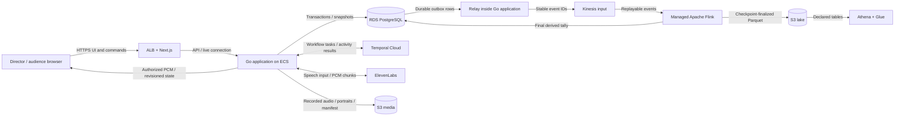

# Monster Theatre — System Design

Status: Design in progress. Requirements, room-owned characters, one create-and-publish request with immutable setup, Temporal setup recovery/compensation, one performance per room, automatic progression without Stop controls, an AWS-hosted milestone, and Temporal Cloud with Go workflows are agreed with the user. Remaining entities, interfaces, business data flows, and the high-level architecture below are a design draft. Deep dives and final design sign-off remain outstanding.

Source of truth: [Product brief](monster-theatre-product-brief.md). Significant choices are recorded in [Decisions](decisions.md).

## 1. Requirements baseline

### Actors and core capabilities

| Actor | Capability | Successful outcome | Important failures |
| --- | --- | --- | --- |
| Director | Create and publish a room in one request, then start its automatic performance | Complete immutable scene/character setup and two validated portraits produce a shareable link and Start button; Start initiates automatic progression | Invalid input/upload, provisioning failure, unauthorized action, duplicate or conflicting Start, explicitly failed run |
| Audience member | Enter, vote, and hear each chosen turn | An anonymous session votes once per eligible round; one committed choice becomes expressive streamed speech | Late/invalid vote, blocked browser audio, delayed tally, paused synthesis |
| Audience member / director / operator | Hear the premiere and inspect saved work | Eight recordings become one uninterrupted performance after a five-second countdown; media and queryable events remain in S3 | Preparation/storage failure, incomplete run, unavailable or delayed lake records |

The director can also act as the demo operator. Operator bucket access is separate from audience room access.

### Agreed scope and invariants

- One active performance across the demo, up to ten audience sessions.
- Each room can host exactly one performance. After completion or failure, another performance requires a new room and audience link.
- One complete setup request creates and publishes the room. There is no editable room draft, setup revision, standalone character resource, or separate publish/upload operation for the director. Any setup change requires a new room.
- Scene and character context are fixed by the creation submission and are immutable when the room becomes ready/published. Start uses that already fixed setup.
- After the initial director Start, progression and bounded retries are automatic; there are no Stop or manual retry controls.
- The first working milestone is reachable remotely on AWS. Temporal Cloud manages durable workflow execution, with Go workers hosted on AWS.
- Room owns two character components, identified only within the room as slots A and B, each with an uploaded portrait reference, name, optional brief, and a hardcoded voice. Portrait bytes remain S3 media assets.
- Eight alternating turns, beginning with A's introduction and ending with B's EXPLAIN + PUNCHLINE. Middle beats are REACT or QUESTION.
- Three distinct dialogue choices and a ten-second voting window for each turn. Generation finishes before the window opens.
- One accepted vote per audience session per turn. Reconnection retains the same identity. Late joiners observe the current phase and become eligible at the next round opening.
- Server receipt time determines eligibility. Retried submissions cannot add votes.
- Flink aggregates/deduplicates votes and produces final tallies. The application commits one immutable winner after all accepted eligible votes are accounted for.
- Most votes wins; ties and zero-vote rounds use a persisted random selection with its reason.
- Audio tags preserve the selected words. Speech retries retain the winner and do not reopen voting.
- The room timeline advances independently of individual browser playback completion.
- The premiere reuses completed turn recordings. All eight recordings and assembled audio must be ready before the countdown.
- An unrecoverable run remains visibly failed/incomplete and retains available artifacts.
- Media and structured lake records are separate, private S3 content. Audience access does not confer bucket access.
- Seven-day default retention, with manual preservation for selected runs, covers associated media and structured records.

Deferred: animation, image interpretation, variable turn counts, selectable voices, microphone input, an in-app library/browser, analytics UI, and strong audience identity enforcement.

### Non-functional acceptance targets

| Concern | Agreed target or rule |
| --- | --- |
| Vote acknowledgement | p95 under 300 ms; acknowledged votes survive worker restart |
| Result latency | Winner committed within one second of window closure under normal operation |
| Speech latency | First audible output p95 under two seconds after submitting/flushing tagged text; measure generation and tagging separately |
| Consistency | One active turn/round per run, strict turn order, immutable winners, current state on reconnect |
| Recovery | Flink recovery within 60 seconds; retain replayable event input; checkpointing does not promise exactly-once speech or browser playback |
| Lake freshness | Finalized queryable records within 60 seconds of performance completion under normal operation |
| Degradation | Pause result progression if Flink cannot finalize; preserve selected text on speech failure; show preparation/retry status on assembly/storage failure |
| Security | Director authentication; room-link audience access; server-held provider keys; private encrypted objects; bounded uploads/text/starts/retries |
| Browser environment | Desktop first; activate audio on Enter theatre or director Start; expose Tap to hear audio when needed |
| Operation | Track generation usage, audio latency, vote-processing lag, checkpoint failures, and synthesis failures |

These are validation targets, not verified provider or deployment guarantees.

### Decision-relevant capacity

- At most 80 accepted votes per performance: eight rounds × ten audience sessions. Retries and rejected submissions add events but must not increase accepted vote totals. This workload does not justify read/write scaling infrastructure; Flink is retained for its explicit learning purpose.
- Each normal completed run has 24 dialogue choices, eight committed choices, and at least eight synthesis attempts. Bounded retry limits remain to be set.
- At least eleven binary media artifacts are referenced by a normal completed run: two portraits, eight turn recordings, and one assembled recording. Scripts and manifests are additional artifacts. Cross-room asset sharing is unnecessary for this milestone.
- There are ten audience listeners plus the director. Stream bandwidth, recording sizes, and storage retention footprint are deferred to the audio/media deep dive, where codecs, duration limits, upload limits, and expected runs per day can inform the estimates.

## 2. Proposed core entities

Authority here means ownership of business truth, not a selected service or database. Physical storage, schemas, and transport choices come later.

| Entity | Stable identity / owner | Responsibility and relationships | Lifecycle | Authority |
| --- | --- | --- | --- | --- |
| Director identity | Authenticated director ID | Owns rooms and is authorized for complete setup submission and Start. Authentication mechanism remains open. | Managed by the chosen authentication mechanism | Authentication establishes identity; application enforces resource ownership |
| Room | Room ID; director ID | Shareable theatre owning immutable scene context, character components A/B and portrait references, audience memberships, and zero or one performance reference | Internal provisioning → ready/published or provisioning failed; no setup edits and no second run | Application for context/state; S3 for portrait bytes |
| Audience session | Session ID; scoped room membership | Anonymous voting identity restored on reconnect. Presence and connection state are distinct from identity. | Joined → disconnected/reconnected; session expiry to be specified | Application |
| Performance | Performance ID; room ID and director ID | One automatic run with immutable setup, ordered turns, current phase, room playback timeline, and artifact references | Running → preparing premiere → countdown → premiering → completed; unrecoverable error from any nonterminal phase → failed | Application |
| Turn | Turn ID; performance ID + ordinal 1–8 | Scheduled speaker/beat, one round, committed dialogue, tagged text, synthesis attempts, selected recording, playback progress | Generating choices → voting → counting → enhancing tags → synthesizing/playing → completed; failures pause the current stage | Application; room timeline determines completion, not listener acknowledgements |
| Voting round | Round ID; exactly one per turn | Three stable choice IDs and texts, opening/deadline, eligibility membership, tally and committed selection | Preparing → open → counting → committed; performance failure before commitment → cancelled | Application owns boundaries/commitment; Flink derives tally |
| Accepted vote | Vote ID; round ID + audience session ID | One durable eligible choice selection with authoritative receipt time. Duplicate/late/invalid submissions are separate inspection events, not extra votes. | Accepted → included in the finalized tally; cannot be changed into a second vote | Application owns acceptance; Flink deduplicates replay and tallies |
| Synthesis attempt | Attempt ID; turn ID + attempt number | Records tagged input, provider/model/voice used, progress, error, and any associated partial or completed audio | Requested → streaming → succeeded or failed; retries have new attempt IDs | Application records attempts; provider supplies speech bytes |
| Media artifact | Artifact ID; linked room/performance/turn/attempt as appropriate | Portrait, turn audio, full audio, script/decisions, or manifest. Stores object reference, readiness/completeness, and preservation/expiry metadata. | Pending → ready or failed/partial → expired, subject to preservation | Application for metadata and readiness; S3 for object bytes |
| Performance event | Event ID + schema version; room/performance/turn IDs where applicable | Durable replayable facts about votes, rounds, turns, synthesis, and playback; references artifacts without embedding media | Durably recorded → replayed/processed → included in finalized lake output | Originating application facts; Flink processing and lake projections are derived |

Dialogue choices belong to the round and do not need an independent lifecycle. The immutable selection belongs to that same round, including counts, chosen ID, and majority/tie/no-vote reason. Selected dialogue alone becomes story history.

Lake metrics are derived records, not a second authority for live room state. Their calculations and query contracts will be defined during the Flink/data-lake design.

### Room-owned setup and dialogue context

Room is the resource boundary for the director's complete setup:

```text
Room
├── Scene: topic, optional description, optional genre
├── Character A: name, optional brief, portrait reference, fixed voice
└── Character B: name, optional brief, portrait reference, fixed voice
```

Characters are components of Room, not independently managed entities. Slots A/B are sufficient identity within a room; there are no standalone character IDs, lifecycles, or CRUD APIs. Database embedding versus child tables is a storage choice that does not change this ownership.

GetRoom returns all static scene/character context together, with portrait references or authorized delivery URLs rather than image bytes. Dialogue generation assembles that immutable room context with the performance's previously selected dialogue, scheduled speaker/beat, and remaining turns. Rejected choices do not become story history. Images remain portraits, not automatically interpreted generation input.

Start does not freeze or revise setup: the submitted context is already fixed, and successful create-and-publish makes it ready for audience admission and Start. Export the room context in the performance's saved script/manifest for standalone inspection; this does not create another editable setup resource.

### Relationships and ownership boundaries

- A director owns rooms; each room has exactly two character slots and room-scoped audience memberships.
- A ready/published room starts at most one performance; each performance references its already immutable room context and owns eight ordered turns. Failure does not restore the room's ability to Start.
- Each turn has one round, three choices, up to ten accepted votes, and zero or more synthesis attempts.
- Each completed turn references exactly one selected completed recording. Failed attempts remain inspectable but are not substituted into the premiere.
- The complete recording and manifest belong to the performance; the manifest links frozen portrait references, ordered turn recordings, and their timing.
- Events connect these entities through stable IDs; retries and replay preserve original fact identities.
- Preserving a performance must preserve its room-owned portraits and associated structured records, not merely its manifest. Cross-room asset sharing is deferred.

### Lifecycle rules that affect later interfaces

1. Create-and-publish must complete room provisioning and both room-owned portrait writes before issuing the shareable link. Start requires that ready state, atomically claims the demo's single active-performance slot, and enforces at most one performance for the room. Concurrent or retried creates/starts cannot create extra rooms/runs for the same idempotency key.
2. A published room can admit observers while a run is active. New membership during an open round does not create eligibility in that round; reconnecting an already eligible session restores its existing eligibility.
3. A round opens only after three valid choices exist. Its eligibility set and server deadline are fixed at opening.
4. Acknowledging acceptance requires durable vote truth. Flink delay cannot silently omit an acknowledged eligible vote; the finalization contract remains a named deep dive.
5. The winner is committed once, before enhancement/synthesis. Replaying a tally cannot reroll a persisted tie-break or no-vote choice.
6. Tagging/speech failures pause the current stage and trigger bounded automatic retries with visible status. Completed rounds are never reopened. Retain the chosen words; a failed speech attempt gets a new attempt identity rather than a new vote result.
7. Streaming and playback can overlap. A turn completes only once its recording is complete and its playback interval has ended on the room timeline. The exact timeline/recovery contract remains open.
8. Exhausted recovery makes the run terminally failed, cancels unfinished progression, and prevents late worker results from starting further playback or changing terminal status. Retain partial artifacts and relevant events; do not label the run completed. Recovery budgets/deadlines remain to be set.
9. Premiere preparation failure keeps the run in preparation with visible automatic-retry status until recovery succeeds or its budget is exhausted. Start the five-second countdown only after all required recordings and complete playback are ready.
10. Completion and artifact readiness are separate from lake freshness. A successful premiere does not imply all checkpoint-finalized Parquet is already queryable.

### Core-entity checkpoint outcome

The user chose **room-owned characters**, **one create-and-publish request with immutable setup**, **one performance per room**, and **automatic progression with no Stop controls**. Setup changes and subsequent runs require a new room and link. See D005, D007, D013, and D014.

Every core capability now maps to identified entities with logical ownership. Proceed to interface design; physical stores and schemas remain open.

## 3. Proposed actor interfaces

Use resource-oriented HTTP commands/queries as the proposed baseline. This defines behavior before choosing services or realtime transports. `/api/v1` is a proposed route prefix, not an existing implementation.

### Director commands and queries

Every operation requires verified director identity and ownership of the target room. Derive owner identity from authentication, never from request-supplied director IDs. Start is the only performance action; all subsequent progression and retries are automatic.

| Operation | Essential request / response | Validation, concurrency, and errors |
| --- | --- | --- |
| `POST /api/v1/rooms` | One `multipart/form-data` request containing scene/character JSON and portraits A/B, plus an idempotency key → `201` with room ID, ready status, and shareable audience link | Require complete valid setup; authenticated director; finish provisioning before success; retries recover the same operation/result, not another room |
| `GET /api/v1/rooms/{roomId}` | No body → director room snapshot including all static scene/character context | Snapshot includes room readiness, current performance phase/revision, legal Start action, and safe error status; no provider credentials |
| `POST /api/v1/rooms/{roomId}/performance` | Idempotency key → `202` with performance ID and current phase | Ready/published, never-started room only; reject global active-run conflict; use already immutable context; same-key retry returns the existing run, different Start after creation returns `409` |

There are no room-edit, separate publication, standalone character, or portrait-replacement APIs. The director submits once, then sees the shareable link and Start button. A form can be edited locally before submission; there is no server-side editable draft.

Idempotency keys are scoped to caller and operation, and to a resource where one already exists. For creation, persist the submitted context and portrait-content fingerprint so retries can recover the same operation; reusing a key with different inputs is a conflict. Phase revisions still protect runtime state transitions, not setup edits. Exact key expiry and retry budgets remain implementation-level choices unless recovery analysis requires stronger constraints.

The create handler waits for setup readiness before returning the link. An HTTP timeout or disconnect does not cancel a durably handed-off setup workflow or trigger compensation. Retrying the same submission/key recovers its current operation or completed response. Never report provisioning as successful while portraits or publication are incomplete.

### Audience commands and queries

The share link carries an opaque room-access capability, not director or bucket permissions. Exchange it on Enter theatre for a room-scoped session credential. Browser Enter theatre also activates local audio; server admission cannot itself guarantee autoplay permission.

| Operation | Essential request / response | Validation, identity, and errors |
| --- | --- | --- |
| `POST /api/v1/audience-sessions` | Room-access capability; existing session credential if reconnecting → room/session identity and current snapshot | Invalid/expired capability rejected; reconnect reuses identity; enforce ten admitted audience sessions; new session during an open round is eligible from the next opening |
| `GET /api/v1/audience/rooms/{roomId}` | Room-scoped session credential → current audience snapshot | May view only its room; no accepted-voter list, director controls, raw capabilities, or bucket access |
| `POST /api/v1/rounds/{roundId}/votes` | Choice ID + submission idempotency key → durable accepted vote receipt, server receipt time | Identity comes from session credential; require eligible session, active open round, valid choice, and receipt before deadline; duplicate same choice returns original receipt; a different choice after an accepted vote returns `409`; invalid/late vote has a visible reason |

The first valid vote is final in this draft: one vote per session per round means no vote-changing operation. A retry of an already accepted submission returns its original receipt even if the round has since closed. A new submission after the deadline is rejected. Atomic acceptance versus close ordering will be resolved in the vote-finalization deep dive.

Disconnection alone does not release identity or an audience slot; otherwise reconnecting could create duplicate voters. Session lifetime/admission cleanup remains to be specified without adding a device-identity guarantee.

### Live state and audio contracts

Define these as logical interfaces for now; the realtime and audio transports are selected after data flows are traced.

- **Subscribe to room state:** verified room audience or owning director receives revisioned phase updates. Updates include performance/turn IDs, speaker, open-round choices, server deadline, own voting eligibility/receipt, committed selection/tally, preparation/error status, and room timeline anchors as relevant. Tallies are revealed after commitment in this draft.
- **Reconnect/resynchronize:** receive a current snapshot and newer updates without a gap. Missing historical messages must not force clients back into an earlier phase. Sequence/revision values distinguish stale updates from current state; clients recover through a snapshot when needed.
- **Receive turn audio:** authorized clients receive ordered arriving audio associated with performance, turn, and synthesis-attempt identity. Distinguish streaming bytes, final recording readiness, provider failure, and room playback progression. Old attempts cannot supersede the selected attempt.
- **Receive premiere playback:** only after preparation succeeds, publish complete playback availability and a server timeline for 5, 4, 3, 2, 1 and the premiere. Listen through an authorized media-delivery mechanism; a room link never grants unrestricted S3 access.
- **Failure/recovery notification:** expose automatically retrying versus terminally failed state. Terminal failure invalidates queued phase/audio work; clients clear playback associated with invalidated attempts. No director action is required or offered.
- **Playback telemetry:** any first-audible or playback-blocked reports are observational, attributable to a session and attempt, and cannot advance the room or change a winner. The exact ingestion interface and metric definition belong to the audio deep dive.

The director subscribes to the same authoritative room progression. Browser-local blocked/buffering/disconnected status is distinct from the room's phase. No Stop or manual retry interface is exposed.

### Visible failures and proposed validation bounds

Use structured failures with a stable code, human-readable message, retryability, and current revision/phase when useful. Baseline HTTP outcomes: `401` absent/invalid credentials, `403` unauthorized role, `404` inaccessible resource, `409` conflicting state/idempotency or closed round, `413` oversize upload, `422` invalid fields/media, and `429` bounded admission/control/retry limits.

Proposed starting limits, subject to audio/provider validation:

| Input | Draft bound |
| --- | --- |
| Portrait | JPEG, PNG, or WebP; up to 5 MiB and 4096 × 4096 pixels; validate decoded content; no animated image |
| Character name | Required in creation request; 1–80 Unicode code points after trimming |
| Character brief | Optional; up to 400 code points |
| Scene topic | Required in creation request; 1–200 code points |
| Scene description | Optional; up to 1000 code points |
| Genre | Optional; up to 80 code points |
| Generated dialogue choice | 1–300 code points; three distinct valid choices before opening voting; reject/regenerate/fallback within bounded attempts |

Character count bounds limit inputs but do not guarantee speech duration. Tagged-text validation, exact provider payload limits, and the timeline's duration policy remain part of the audio/provider deep dive. Do not expose raw provider failures or credentials in user errors.

### Interface checkpoint outcome

The user removed Stop controls and requested automatic flow. Keep the initial Start from the agreed journey; automate every subsequent stage and bounded retry. Setup now uses a single complete create-and-publish request, with no edit/upload/publish actions afterward. See D007 and D014.

## 4. Business data flows

These sequences establish business ownership, ordering, and failure behavior without selecting internal components or durable transports.

### Room setup and admission

1. Director submits complete scene/character context and portraits A/B in one authenticated multipart request with an idempotency key. Validate both files and all required inputs before provisioning effects. Associate the submission with a durable creation identity and input fingerprint.
2. The API stages validated portrait bytes in private S3 storage and durably hands off setup intent to Temporal using the creation identity and object references. Raw image bytes do not enter workflow history. Staging must also be recoverable/cleanable if the API fails before workflow start.
3. The setup workflow creates an internal `provisioning` Room with immutable context, copies both portraits to deterministic room-owned keys, and verifies readiness. Activities are idempotent; a crash/retry reconciles existing state and objects rather than creates duplicates.
4. In one PostgreSQL transaction, mark the Room `ready` (published), persist final portrait references and one audience-link token, and record the readiness event. No audience admission, Start, or successful creation response is permitted before this commit.
5. The original create request returns `201` with room ID and shareable link after readiness. The director sees that link and Start. Delete staging objects afterward; staging cleanup failure does not revoke a ready room. HTTP response loss does not undo publication; the same-key retry returns the existing link.
6. Enter theatre admits or restores a room-scoped audience session and returns current state. The browser activates audio locally. New sessions during an open round wait until the next round to vote.
7. Start atomically claims the single active-run slot and creates the room's only performance using already immutable setup. Acknowledge only after that state and recoverable workflow-start intent are durable. A retry returns the same result.

### Setup compensation and recovery

The setup workflow is separate from the performance workflow. Its publication transaction is the setup success boundary; this flow is not a cross-system atomic transaction.

- On an unrecoverable setup failure before readiness, reconcile any ambiguous database commit first. If the Room is already ready, return its existing link and do not compensate successful setup.
- For definitively failed provisioning, transition it to failed so late attempts cannot publish it, delete room-owned portrait objects belonging to that creation, and clean its staging objects. Retain enough failed-operation metadata to diagnose/recover the submission; failed provisioning is not an editable draft.
- Register compensations before effects that might succeed despite a timeout. Deletion and failure transitions must be idempotent and conditional on the matching creation identity. Compensations have their own retries; cleanup failure must remain visible to operators and be picked up by reconciliation.
- Track staged objects against durable creation intent and expire/reconcile abandoned staging from failures before workflow start. Do not let staging expiry race an active setup operation. Reconcile late/orphaned copy results as well as missing metadata.
- A ready Room's setup is immutable. Any requested context or portrait change is a new creation with a new idempotency key, room ID, and link.
- A later performance failure retains the ready Room, portraits, and performance artifacts for inspection. It never triggers setup compensation.

Required setup acceptance scenarios: valid single-submit returns a ready room/link with both S3 portraits; missing/invalid data returns no usable room; a failed second portrait copy compensates the first; worker restart recovers the same creation; a lost response and same-key retry return the original link; changed input with the same key conflicts; ambiguous publication success is reconciled without deleting ready assets; failed cleanup is retried/reconciled; setup cannot be edited and failed/incomplete provisioning cannot Start.

### One turn, repeated eight times

1. **Generate choices:** application retrieves all static scene/character context from the immutable Room, adds the performance's selected dialogue, scheduled speaker/beat, and remaining turns, and invokes generation asynchronously. Validate three distinct lines; use bounded retries and a valid fallback. Persist choices before opening the round; rejected choices never enter story history.
2. **Open round:** application records the immutable choice IDs, eligible session set, opening time, and ten-second server deadline, then notifies clients. Replayed work cannot open another round for the same turn.
3. **Accept votes:** synchronous application receipt checks identity, eligibility, choice, deadline, and uniqueness. Durably persist acceptance plus replayable processing intent before acknowledgement. Same-submission retries return the original receipt; rejected submissions produce inspection events without contributing votes.
4. **Close and finalize:** application freezes admission at the deadline and emits a durable closure boundary that can prove completeness. Flink consumes/replays accepted input, deduplicates it, and emits all three counts only after every eligible accepted vote before that boundary is included. The concrete boundary/source protocol remains open; processing-time arrival alone is insufficient.
5. **Commit selection:** application validates a result against the matching round/boundary, persists counts and one majority/tie/no-vote selection atomically, and advances once. Repeated results return the persisted choice and cannot reroll randomness. While result processing recovers, show Counting votes… and accept no new votes for the closed round.
6. **Enhance tags:** application uses the immutable winning text to generate delivery tags and validates preservation of its words. Persist original and tagged text. Retry automatically within a budget; final fallback policy remains to be validated against the chosen model/provider.
7. **Synthesize, stream, and record:** application creates a distinct durable attempt, submits tagged text to ElevenLabs, relays ordered chunks to authorized listeners, and records the same attempt audio. Persist progress/events and final recording readiness. Retry a failed attempt automatically without reopening voting; interrupted partial playback and replacement-attempt timing are an audio deep dive.
8. **Complete turn:** after complete recording readiness and the end of the room playback interval, persist completion and automatically schedule the next turn. Individual browser completion/telemetry cannot block this transition. After turn eight, enter premiere preparation instead.

Each automatic stage requires durable pending/completed intent and an identity that makes recovered work distinguishable from new work. This does not imply exactly-once external generation. The storage and execution mechanism is intentionally deferred to architecture design.

### Premiere and completion

1. Verify eight completed selected recordings, then assemble them in speaker/turn order without regenerating speech. Persist complete audio, script/decisions, and a manifest linking setup, originals, recordings, and timing. Repeated preparation reuses ready inputs/outputs rather than creates another performance.
2. Retry assembly/storage failures automatically and expose preparation status. Do not start countdown while any required recording/full playback is missing.
3. Persist the server countdown/playback timeline and notify clients. Count down five seconds, then play complete audio uninterrupted. Clients resynchronize to current state rather than restarting the voting sequence.
4. At the room timeline's premiere end, mark the performance completed and release the demo-wide active-run slot. The room remains permanently used. Completion does not promise every browser heard every byte or every lake file is already queryable.
5. If an essential stage exhausts its recovery budget, mark failed, invalidate pending progression, retain available artifacts, and release the active-run slot. A fresh attempt at the product journey requires a new room. Exact budgets/deadlines are still proposed design parameters.

### Inspection, lake output, and retention

1. Durably recorded schema-versioned events enter replayable input. Flink derives participation/latency metrics and structured records using stable room/performance/turn/attempt/event identities.
2. Write Parquet to the separate lake area; successful checkpoints finalize files. The query tool reads finalized output only. Track lag independently from live room progression; lake delay alone must not rerun speech.
3. The operator uses private S3 access to inspect/download media, script, and manifest; audience sessions receive only authorized playback delivery. Preservation is an operator operation, not an audience control.
4. Apply seven-day expiry to related media and structured data unless a run is preserved. Date-partitioned lake files can mix preserved and expiring runs, so the deletion/preservation mechanism must be resolved before adopting bucket lifecycle rules.

### Data-flow checkpoint outcome

All three core capabilities now have end-to-end business paths. The user chose an AWS-hosted first milestone and Temporal Cloud with Go workflows. See D008 and D009.

## 5. Proposed high-level architecture

### Recommended baseline

Keep one Go application responsible for business state, HTTP, live delivery, Temporal activities, and event publication. Use PostgreSQL for authoritative state and its transactional event/outbox log; feed that log into Kinesis for a managed Flink job. Do not split into independently owned microservices for this workload.

| Component | Proposed role | Why it is needed |
| --- | --- | --- |
| Next.js web frontend | Director setup and audience theatre, static portraits, controls, voting, audio player | Preferred web stack and the agreed browser experience |
| Application Load Balancer + ECS Fargate | HTTPS ingress; containerized Next.js and Go runtime | AWS hosting for invited users; long-lived browser/provider streams |
| Go application | APIs, authorization, room state, event/outbox relay, live audio fan-out, and Temporal worker | Preferred backend; keep one business-state authority |
| RDS PostgreSQL | Room/session/performance/round/vote/attempt/artifact metadata; durable events, outbox, room updates, derived Flink tallies | Atomic acceptance, uniqueness, immutable commitment, restart recovery |
| Temporal Cloud | One setup workflow per creation for provisioning/compensation; a separate workflow per performance for durable timers, activities, retries, eight-turn progression and finale | Accepted engine for recoverable setup and automatic performance |
| Kinesis Data Streams | Replayable Flink input, with stable event IDs and performance partition key | Separate vote acknowledgement from recoverable stream processing |
| Amazon Managed Service for Apache Flink | Keyed deduplication/tallies, completeness gating, lifecycle metrics, checkpointed Parquet output | Deliberate learning objective; managed runtime rather than operating a cluster |
| Private S3 media bucket | Private setup staging and room-owned original portraits; immutable attempt/turn recordings, full audio, script/decisions, manifest | Recoverable portrait provisioning, exact recorded replay, and preserved inputs |
| Private S3 lake bucket | Finalized Parquet events/metrics; separate operational checkpoint area if required by runtime | Queryable historical data without media payloads |
| Athena + Glue Data Catalog | Operator SQL inspection of finalized Parquet using declared schemas | Agreed lake inspection; no analytics UI |
| Cognito user pool | Director login; administrator-created users, no public signup | Limited director access without implementing a password system |
| Secrets Manager, IAM task roles, CloudWatch | Provider/Temporal credentials, scoped AWS access, operational logs/metrics | Server-side keys and observable recovery/latency |

Physical region, resource sizes, availability configuration, and estimated recurring cost remain open. Start with one active application task for the demo; this deliberately prioritizes simplicity over seamless stream failover. Durable state survives task replacement, but in-flight audio may be interrupted.

AWS manages Flink infrastructure and checkpoints; the application still owns input/result correctness. [AWS Flink overview](https://docs.aws.amazon.com/managed-flink/latest/java/what-is.html). Athena reads Parquet using catalog metadata. [Athena data sources](https://docs.aws.amazon.com/athena/latest/ug/work-with-data-stores.html). Cognito can disable self-registration. [Cognito user creation policy](https://docs.aws.amazon.com/cognito/latest/developerguide/user-pool-settings-admin-create-user-policy.html).



### Responsibility and transaction boundaries

- **PostgreSQL is authoritative for business state.** Enforce one room creation per director/idempotency key, one performance per room, one accepted vote per round/session, one result commitment per round, and one active run through constraints plus a transactionally claimed demo guard row. Setup is immutable; phase revisions protect runtime transitions. External calls run outside database locks.
- **Atomic state and publication:** each business transition commits its event/outbox record and audience-visible room update in the same transaction. The relay publishes at least once and preserves event identities; mark publication only after acknowledgement. Creation records recoverable intent to start setup workflow `room-setup/{creationId}` once staging is ready; Start records intent for the separate workflow `performance/{id}`. A recovered relay reuses existing workflow identities, never creates a second room or run. Room readiness and its link token commit atomically after portraits are ready.
- **Temporal orchestrates; PostgreSQL validates transitions.** Workflow code performs deterministic orchestration and uses durable timers; activities perform database/provider/S3 I/O. An activity retry reads durable state and returns completed work or conditionally claims a new attempt. Keep media bytes out of workflow history. This follows [Temporal's durable timer model](https://docs.temporal.io/develop/go/workflows/timers).
- **Flink's result table is derived.** Give its database role access only to its result tables, not winner/phase/accepted-vote mutation. Emit final results keyed by round and closure identity through idempotent JDBC writes. The Go activity waits for a complete result, validates identity/completeness, and commits the winner exactly once. Connector version and flush settings require verification; JDBC supports primary-key-based idempotent writes, but the currently published stable page notes missing connector support for its newest engine version. [Flink JDBC connector](https://nightlies.apache.org/flink/flink-docs-stable/docs/connectors/table/jdbc/).
- **No checkpoint wait in live winner commitment.** A derived complete tally may be persisted before the next checkpoint; replay must reproduce an identical tally and cannot alter an already committed winner. Parquet finalization follows checkpoints separately.
- **S3 and database updates converge.** Upload immutable attempt-specific objects, then conditionally mark readiness after successful storage. Recovery can reconcile an existing object before uploading again. Unselected/partial attempts cannot become the premiere's recording.

### Realtime and audio direction

Propose one same-origin WebSocket for revisioned room-state messages and binary PCM delivery, while setup and votes remain ordinary HTTP. This departs from the pattern's SSE default for one-way state because binary audio shares the connection without text/base64 framing. Authenticate on connection and authorize its room; use heartbeats, bounded buffers, attempt/sequence identifiers, and snapshot recovery. Do not run websocket traffic through a response-buffering frontend handler; route its path directly to Go at ingress.

Since the initial Go runtime also owns synthesis and fan-out, there is no additional audio-routing broker. Durable room revisions can be read/replayed from PostgreSQL. In-memory connection maps/chunk queues are delivery state, never vote or performance truth. Slow clients resynchronize rather than blocking the provider or retaining unbounded buffers.

Propose ElevenLabs Text to Dialogue over a backend WebSocket with `eleven_v4`, both fixed voices registered, explicit turn boundaries/flush, and keep-alive through generation/voting gaps. The provider's guide distinguishes multi-voice `eleven_v4` from one-voice-per-connection turbo and documents a 20-second inactivity timeout. [Realtime dialogue guide](https://elevenlabs.io/docs/eleven-api/guides/how-to/websockets/realtime-tdd).

Propose 24 kHz mono 16-bit PCM after confirming account/output support. This simplifies frame indexing, turn recording, and concatenation into a valid WAV premiere without regenerating speech or concatenating encoded-file headers. Provider final-turn signaling must be validated with a real request; its API recommends PCM where exact boundaries matter. [Dialogue WebSocket API](https://elevenlabs.io/docs/api-reference/text-to-dialogue/ttd-websocket). Audio tags/voice IDs/model availability and the browser AudioWorklet path require a provider/browser spike before implementation assumptions are finalized.

Illustrative capacity at that proposed format: 48,000 bytes/second per listener; eleven listeners consume about 0.53 MB/second of audio payload. Assuming 15–30 seconds per turn, selected turn audio totals 5.76–11.52 MB; storing both individual recordings and the assembled premiere approximately doubles that, before portraits/failed attempts. These are estimates, not a speech-duration guarantee. One small container is plausible for fan-out; benchmark the latency target before selecting its size.

Receive both small portraits in the single authenticated multipart create request and validate them in Go: proposed bounds are two 5 MiB images per room. Stage bytes privately before passing only their references to Temporal; copy them to immutable room-owned keys before publication, and reconcile abandoned staging. Live audio already passes through Go to record exactly what it streams. Serve completed portraits/premiere media through short-lived, per-object authorized URLs rather than arbitrary bucket browsing. Direct browser-to-S3 upload/CDN infrastructure is unnecessary until measured transfer load justifies it.

### Three required deep dives

1. **Vote receipt, completeness, and restart.** Define the precise server receipt/admission boundary and how closing excludes new votes while including every eligible accepted vote. Proposed closure payload carries the explicit accepted vote ID set (at most ten), count, and boundary ID; Flink emits only after deduplicating and seeing that complete set, including zero-vote closure. Reordered/duplicate input must be safe: Kinesis `PutRecords` does not guarantee record ordering. [Kinesis write contract](https://docs.aws.amazon.com/kinesis/latest/APIReference/API_PutRecords.html). Finalize the admission/closure race, replay retention, JDBC flushing, and failure/recovery tests before sign-off.
2. **Audio timeline and interrupted attempts.** Define first-chunk buffering, authoritative sample/time anchors, provider underrun handling, slow/reconnecting browser behavior, automatic speech retry after partial audible output, task replacement, and premiere resume. The simplest proposed interrupted-attempt policy restarts the same selected line in a fresh attempt and visibly resets that turn's playback; only the completed elected attempt enters the premiere. This can repeat a partial line and must be accepted as a tradeoff. Vote/tag decisions remain fixed.
3. **Lake finalization, retention, and preservation.** Choose compatible Flink/Kinesis/JDBC/Parquet/S3 components, checkpoint configuration, schemas and metric definitions, query table layout, and deletion/preservation procedure. FileSink streaming output is safely finalized only through successful checkpoints. [Flink FileSink](https://nightlies.apache.org/flink/flink-docs-stable/docs/connectors/datastream/filesystem/). The managed runtime defaults to 60-second checkpoint intervals unless configured as custom, which leaves insufficient margin to promise finalized files within 60 seconds after completion. Propose a custom 10-second interval and measure successful completion/visibility, rather than equating interval with freshness. [AWS checkpoint configuration](https://docs.aws.amazon.com/managed-flink/latest/apiv2/API_CheckpointConfigurationDescription.html).

### Technology choice requiring an explicit tradeoff

**Current default:** Go for backend/workflows; Python where a Python-native AI/data library provides a concrete need.

**Alternative:** Java for the single Flink DataStream job; Go remains the application language.

**Why:** Flink has no native Go job API, and Java provides direct access to the keyed state, low-latency processing, and connectors this job needs. AWS specifically points to Java/Scala for low latency and Java for asynchronous I/O. [Supported Flink APIs](https://docs.aws.amazon.com/managed-flink/latest/java/what-is.html).

**Tradeoff:** A Java build/toolchain and connector compatibility testing in addition to Go/TypeScript. PyFlink is an alternative, but its connector/API limitations need validation before preferring it for this job. This choice is proposed, not accepted.

Next.js, Go, PostgreSQL, and AWS follow the preferred stack. Temporal Cloud is an accepted exception to an entirely AWS-managed control plane. Encore is not assumed: its infrastructure simplification must outweigh integrating explicit AWS services and raw audio streaming before introducing it. A direct LLM-call adapter is sufficient for generation/tagging; no agent framework or separate Python service is currently justified.

### Architecture checkpoint

The baseline traces setup/admission, durable voting, streamed speech, premiere, and lake inspection end to end. Proposed components remain reviewable choices; no resources have been provisioned.

Material unresolved items: Java versus PyFlink for the job, generation provider/model, AWS/Temporal region and recurring-cost envelope, receipt/closure contract, interrupted speech/reconnect behavior, exact retry/deadline budgets, and lake preservation/deletion. These must be resolved before design sign-off and the implementation plan.

## 6. Remaining design stages

1. **Deep dives:** resolve the three ranked issues above and their measurable acceptance checks; settle provider/region/cost choices that affect the design.
2. **Design sign-off:** review the complete requirements trace and significant proposals with the user; update accepted decisions, then create the implementation plan.

No dependency versions or implementation plan have been selected at this stage.
